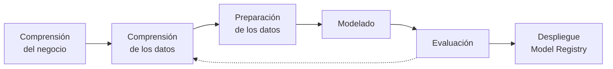

# Predicción de ausentismo a turnos médicos (*No-Show*)

## Descripción del proyecto

El ausentismo de pacientes a turnos médicos ya agendados (*no-show*) genera huecos de agenda que no pueden reasignarse a tiempo. También aumenta las listas de espera y los costos operativos, y reduce la eficiencia en el uso de personal, equipamiento e insumos.

Este proyecto construye y compara **modelos de clasificación** que estiman, a partir de datos históricos, la probabilidad de que un paciente **no asista** a su turno. Con esa estimación anticipada, un centro de salud puede intervenir de forma proactiva con recordatorios adicionales, sobreturnos controlados o reprogramaciones.

| Aspecto | Detalle |
|---|---|
| **Tarea de minería de datos** | Clasificación binaria |
| **Variable objetivo** | `no_show` (1 = no asistió, 0 = asistió) |
| **Metodología** | CRISP-DM |
| **Desafío principal** | Desbalance de clases (79,8% asiste / 20,2% no asiste) |
| **Momento de la predicción** | Antes del día del turno, cuando el centro de salud todavía puede actuar |
| **Modelo final** | LightGBM optimizado con Optuna, umbral de decisión 0,230 |
| **Desempeño en prueba** | PR-AUC 0,388 (IC 95%: 0,369 – 0,406) · ROC-AUC 0,741 · recall 74,5% |

---

## Conjunto de datos

| Campo | Valor |
|---|---|
| **Nombre** | Medical Appointment No Shows |
| **Fuente** | Kaggle — [joniarroba/noshowappointments](https://www.kaggle.com/datasets/joniarroba/noshowappointments) |
| **Origen** | Registros públicos de turnos médicos de Vitória, Brasil (2016) |
| **Instancias** | 110.527 turnos de 62.299 pacientes (110.516 tras la limpieza) |
| **Atributos** | 14 originales (13 predictores candidatos + variable objetivo) |
| **Período de turnos** | 29/04/2016 a 08/06/2016 (27 días con turnos) |

Cada fila representa un turno agendado. Incluye:

- datos demográficos del paciente (`Gender`, `Age`);
- el barrio de atención (`Neighbourhood`);
- condiciones de salud preexistentes (`Hipertension`, `Diabetes`, `Alcoholism`, `Handcap`);
- inscripción en un programa social (`Scholarship`);
- recepción de recordatorio por SMS (`SMS_received`);
- las fechas de agendamiento (`ScheduledDay`) y del turno (`AppointmentDay`).

> **Nota:** el archivo original **no se versiona** en el repositorio. Ver [Instalación](#instalación-y-ejecución) para descargarlo.

---

## Enfoque metodológico

El trabajo sigue las fases de **CRISP-DM**:



| Fase CRISP-DM | Notebook |
|---|---|
| Comprensión de los datos | `01_EDA.ipynb` |
| Preparación de los datos | `02_preparacion.ipynb` |
| Modelado | `03_modelado_baseline.ipynb`, `04_optimizacion_optuna.ipynb` |
| Evaluación y despliegue | `05_evaluacion_final.ipynb` |

### Decisiones clave

**Desbalance de clases.** Se analizó antes de entrenar. Un clasificador trivial que siempre predice "asiste" alcanza 79,8% de exactitud con recall 0, por lo que la exactitud **no** es la métrica principal. Se compararon cuatro estrategias aplicadas **solo sobre entrenamiento**: sin tratamiento, ponderación de clases, submuestreo aleatorio y SMOTE.

La evidencia mostró que el desbalance afecta a la **elección del umbral de decisión**, no a la capacidad de discriminación de los modelos. Por eso se resolvió **ajustando el umbral** sobre predicciones fuera de *fold*, no remuestreando los datos.

**Métricas.** Se priorizan:

- PR-AUC, métrica principal (piso de referencia: la tasa de no-show, ~0,20);
- ROC-AUC (piso de referencia: 0,5);
- recall y F1 de la clase *no-show*;
- exactitud balanceada;
- Brier, para la calibración de las probabilidades.

**Prevención de fuga de información (*data leakage*).** Se aplican tres medidas:

1. **Partición agrupada por paciente.** El 39% de los pacientes tiene más de un turno, y el 82% de los grupos de turnos de un mismo paciente en un mismo día tiene igual resultado. Todos los turnos de un paciente quedan del mismo lado de la partición.
2. **Historial estrictamente anterior.** Los atributos de historial usan solo turnos de días anteriores, nunca del mismo día ni posteriores.
3. **Transformaciones aprendidas dentro del pipeline.** La codificación por objetivo, el escalado y el remuestreo se ajustan dentro de cada *fold*, solo con datos de entrenamiento.

La partición temporal se descartó como estrategia principal: el período abarca solo 27 días con turnos y el conjunto de prueba quedaría reducido a una semana.

**Evaluación honesta.**
- La validación cruzada, la optimización y la elección del umbral usan solo el conjunto de entrenamiento, con **5 *folds* fijos** guardados en el dataset.
- El conjunto de prueba se utilizó **una única vez**, en el notebook 05, con modelos definidos de antemano.
- Los intervalos de confianza en prueba se obtienen con *bootstrap* por paciente.

### Modelos

| Modelo | Familia de preprocesamiento | Rol |
|---|---|---|
| `DummyClassifier` | — | Línea base de referencia |
| Regresión Logística | Lineal | Referencia lineal |
| Árbol de Decisión | Árboles | Interpretabilidad y extracción de reglas |
| Random Forest | Árboles | Ensamble por *bagging* |
| LightGBM / XGBoost | Árboles | Ensambles por *gradient boosting* |

### Preprocesamiento por familia de modelos

| Transformación | Árboles | Lineal |
|---|---|---|
| Atributos numéricos | Sin cambios | `log1p` en atributos asimétricos y estandarización |
| Edad | Numérica | Discretizada en 9 tramos con *one-hot* |
| Día de la semana | Ordinal (0 a 4) | *One-hot* |
| Barrio (81 categorías) | Codificación por objetivo (`TargetEncoder`) | Codificación por objetivo y estandarización |
| Binarias | Sin cambios | Sin cambios |
| **Columnas resultantes** | **18** | **28** |

### Optimización y trazabilidad

**Optuna.** Optimizó los hiperparámetros de los candidatos con este protocolo:
- muestreador TPE con semilla fija;
- poda con `MedianPruner` y PR-AUC como objetivo;
- 60 *trials* por modelo;
- el primer *trial* de cada estudio es la configuración por defecto, para que el resultado optimizado no pueda quedar por debajo del baseline;
- la estrategia de desbalance se trata como un hiperparámetro más.

**MLflow.** Registra cada corrida con base SQLite (`mlflow.db`) y artefactos en `mlartifacts/`. De cada corrida guarda:

- parámetros del modelo y del clasificador;
- media y desvío de cada métrica entre *folds*, o métricas de prueba con intervalos de confianza;
- artefactos (métricas por *fold*, historial de *trials*, figuras, modelo);
- etiquetas de trazabilidad: *hash* SHA-256 del dataset, semilla, *commit* de Git, datos utilizados y etapa.

La duración registrada de cada corrida incluye el entrenamiento. Los experimentos ejecutados con la muestra llevan el sufijo `_muestra`. Los notebooks 04 y 05 archivan las corridas anteriores de su experimento al reejecutarse, para no duplicarlas.

| Experimento MLflow | Contenido | Corridas |
|---|---|---|
| `01_baseline` | Todos los modelos con parámetros por defecto | 6 |
| `02_desbalance` | Modelos × estrategias de tratamiento del desbalance | 15 |
| `03_optuna` | Un estudio por candidato, con una corrida hija por *trial* | 4 + 240 |
| `04_modelo_final` | Modelos evaluados en prueba, con umbral e intervalos de confianza | 5 |

El modelo final se registra en el **Model Registry** de MLflow como `noshow_modelo_final`, con su firma de entrada y salida. El notebook 05 verifica que el modelo recargado desde el registro reproduzca exactamente las mismas predicciones.

---

## Flujo de trabajo: muestra de desarrollo y dataset completo

Para no procesar el dataset completo en cada prueba, el código se desarrolla sobre una **muestra representativa** y los resultados finales se obtienen siempre con el **dataset completo**.

| Paso | Descripción |
|---|---|
| 1 | `scripts/crear_muestra.py` genera `data/interim/muestra_noshow.csv` (~15% de los pacientes, ~16.700 turnos) |
| 2 | Cada notebook se desarrolla y prueba con `USAR_MUESTRA = True` |
| 3 | La ejecución definitiva se hace con `USAR_MUESTRA = False` (dataset completo) |
| 4 | Los resultados del informe provienen solo de la ejecución definitiva |

**Criterios de la muestra:**

- Se seleccionan **pacientes completos** (todos sus turnos), no filas sueltas, para conservar el historial.
- El muestreo se estratifica por "tuvo alguna ausencia" × "cantidad de turnos".
- Siempre se incluyen los pacientes con anomalías conocidas, para poder probar el código de limpieza.

Todos los indicadores de la muestra difieren del original en menos de un punto porcentual (`reports/tables/muestra_resumen.md`). Los archivos, experimentos y modelos generados a partir de la muestra llevan el sufijo `_muestra`.

---

## Estructura del repositorio

```text
tfi-mineria-datos-noshow/
├── data/
│   ├── raw/                              # Dataset original (no versionado)
│   ├── interim/                          # Muestra de desarrollo (no versionada)
│   └── processed/                        # No versionado
│       ├── turnos_procesados.csv         # Dataset limpio, con atributos, partición y folds
│       └── metadatos_preparacion.json    # Atributos, conteos, semilla y hash SHA-256
├── docs/
│   ├── propuesta/                        # Propuesta de TFI aprobada
│   └── capturas/                         # Capturas de MLflow para el anexo del informe
│       ├── mlflow_01_corridas.png
│       ├── mlflow_02_comparacion_desbalance.png
│       ├── mlflow_03_detalle_corrida.png
│       ├── mlflow_04_artefacto_folds.png
│       ├── mlflow_05_optuna_estudios.png
│       ├── mlflow_06_optuna_lightgbm_trials.png
│       ├── mlflow_07_modelo_final_evaluacion.png
│       ├── mlflow_08_model_registry.png
│       └── mlflow_09_artefactos_modelo.png
├── mlartifacts/                          # Artefactos de MLflow (no versionado)
├── models/                               # No versionado
│   ├── modelo_final.joblib               # Pipeline completo del modelo final
│   └── modelo_final.json                 # Umbral, parámetros, hash, commit y métricas
├── notebooks/
│   ├── 01_EDA.ipynb
│   ├── 02_preparacion.ipynb
│   ├── 03_modelado_baseline.ipynb
│   ├── 04_optimizacion_optuna.ipynb
│   └── 05_evaluacion_final.ipynb
├── reports/
│   ├── figures/                          # 31 figuras (prefijos eda_, prep_, mod_, opt_, fin_)
│   ├── tables/                           # Tablas CSV, resúmenes Markdown por etapa y verificacion.md
│   └── informe_final.md                  # Informe del TFI (se exporta a PDF)
├── scripts/
│   ├── crear_muestra.py                  # Genera la muestra de desarrollo
│   ├── reiniciar_y_ejecutar.ps1          # Borra las salidas y ejecuta todo el proyecto desde cero
│   └── verificar_salidas.py              # Verifica que todas las salidas estén completas y sean consistentes
├── src/
│   ├── __init__.py
│   ├── config.py                         # Rutas, semilla y constantes globales
│   ├── data.py                           # Carga, limpieza y carga del dataset procesado
│   ├── features.py                       # Atributos, historial, partición y preprocesadores
│   ├── modeling.py                       # Modelos y estrategias de desbalance
│   ├── optimization.py                   # Espacios de búsqueda de Optuna y configuración inicial
│   ├── evaluation.py                     # Métricas, validación cruzada, umbral y bootstrap
│   ├── reporting.py                      # Figuras, tablas, Markdown y tasas con IC
│   └── tracking.py                       # Registro de experimentos en MLflow
├── mlflow.db                             # Base de MLflow (no versionada)
├── .gitattributes
├── .gitignore
├── requirements.txt
└── README.md
```

### Módulos de `src/`

| Módulo | Funciones principales |
|---|---|
| `data.py` | `cargar_datos_crudos`, `limpiar_datos`, `cargar_procesados`, `ruta_procesados` |
| `features.py` | `crear_atributos`, `agregar_historial`, `asignar_particiones`, `iterador_folds`, `construir_preprocesador`; listas de atributos por familia (`ATRIBUTOS_ARBOL`, `ATRIBUTOS_LINEAL`) |
| `modeling.py` | `crear_clasificador`, `crear_pipeline` (preprocesamiento → remuestreo opcional → clasificador), `atributos_de`; catálogos `MODELOS` y `ESTRATEGIAS` |
| `optimization.py` | `sugerir_parametros`, `parametros_desde_trial`; `CONFIG_INICIAL`, `ESTRATEGIAS_POR_MODELO`, `DESCRIPCION_ESPACIOS` |
| `evaluation.py` | `calcular_metricas`, `evaluar_cv`, `proba_entrenamiento`, `resumir_folds`, `umbral_f1_optimo`, `umbral_para_recall`, `umbral_para_capacidad`, `metricas_ponderadas`, `bootstrap_por_grupo` |
| `tracking.py` | `configurar_experimento` (con opción `reiniciar`), `etiquetas_base`, `registrar_corrida`, `exportar_corridas` |
| `reporting.py` | `guardar_figura`, `guardar_tabla`, `tabla_markdown`, `tasa_con_ic`, `tasa_por` |

---

## Instalación y ejecución

### Requisitos

- Python 3.12
- Git

### 1. Clonar y preparar el entorno

**Windows (PowerShell):**

```powershell
git clone <URL-del-repositorio>
cd tfi-mineria-datos-noshow
python -m venv .venv
.\.venv\Scripts\Activate.ps1
pip install -r requirements.txt
```

**Linux / macOS:**

```bash
git clone <URL-del-repositorio>
cd tfi-mineria-datos-noshow
python3 -m venv .venv
source .venv/bin/activate
pip install -r requirements.txt
```

> **Dependencias de MLflow:** `requirements.txt` fija `sqlalchemy==2.0.36` y `alembic==1.14.0`. MLflow 2.19 admite cualquier SQLAlchemy menor a 3, pero la versión 2.1 eliminó una clase que MLflow utiliza, lo que impide crear la base de experimentos.

### 2. Descargar el dataset

1. Descargar el dataset desde [Kaggle](https://www.kaggle.com/datasets/joniarroba/noshowappointments).
2. Copiar el archivo `KaggleV2-May-2016.csv` en `data/raw/`.

### 3. Ejecutar el proyecto completo (recomendado)

Antes de ejecutar, hacer un *commit*: la etiqueta `git_commit` de MLflow identifica así la versión exacta del código que produjo cada resultado.

```powershell
powershell -ExecutionPolicy Bypass -File .\scripts\reiniciar_y_ejecutar.ps1 -IncluirMuestra
```

El script:

1. Controla el entorno: entorno virtual, Jupyter, dataset original y cambios sin *commit*.
2. Borra las salidas generadas. Conserva el dataset original, las capturas, los notebooks y el código.
3. Regenera la muestra de desarrollo (con `-IncluirMuestra`).
4. Ejecuta los cinco notebooks en orden con el dataset completo. Se detiene ante el primer error.
5. Ejecuta la verificación final.

| Opción | Descripción |
|---|---|
| `-Hasta N` | Ejecuta solo hasta el notebook N (1 a 5) |
| `-IncluirMuestra` | Regenera también la muestra de desarrollo |
| `-SoloLimpiar` | Solo borra las salidas, sin ejecutar |
| `-Forzar` | No pide confirmación antes de borrar |

### 4. Ejecutar notebooks individualmente

```powershell
jupyter lab
```

Cada notebook tiene al inicio el interruptor `USAR_MUESTRA`, que debe estar en `False` para la ejecución definitiva. Los notebooks 04 y 05 tienen además parámetros de presupuesto (`N_TRIALS` y `N_BOOTSTRAP`).

| Orden | Notebook | Fase CRISP-DM | Salidas principales |
|---|---|---|---|
| 1 | `01_EDA.ipynb` | Comprensión de los datos | 11 figuras `eda_*`, `eda_resumen.md` |
| 2 | `02_preparacion.ipynb` | Preparación de los datos | Dataset procesado y metadatos, 3 figuras `prep_*`, `prep_resumen.md` |
| 3 | `03_modelado_baseline.ipynb` | Modelado | Experimentos `01_baseline` y `02_desbalance`, 6 figuras `mod_*`, `mod_candidatos.csv`, `mod_resumen.md` |
| 4 | `04_optimizacion_optuna.ipynb` | Modelado (optimización) | Experimento `03_optuna`, 4 figuras `opt_*`, `opt_seleccion.json`, `opt_resumen.md` |
| 5 | `05_evaluacion_final.ipynb` | Evaluación y despliegue | Experimento `04_modelo_final`, modelo registrado, `models/modelo_final.*`, 7 figuras `fin_*`, `fin_resumen.md` |

### 5. Verificar las salidas

```powershell
python scripts\verificar_salidas.py
```

Ejecuta más de 100 controles: versiones de Python y librerías, archivos esperados, notebooks completos y sin errores, integridad del dataset, particiones, corridas de MLflow, modelo registrado y coherencia entre etapas. El detalle queda en `reports/tables/verificacion.md`.

### 6. Consultar los experimentos en MLflow

```powershell
mlflow ui --backend-store-uri sqlite:///mlflow.db
```

Luego abrir <http://127.0.0.1:5000> en el navegador.

### 7. Usar el modelo final

```python
import joblib, json
modelo = joblib.load("models/modelo_final.joblib")
meta = json.load(open("models/modelo_final.json", encoding="utf-8"))
proba = modelo.predict_proba(turnos[meta["atributos"]])[:, 1]   # turnos: DataFrame con los 18 atributos
alerta = proba >= meta["umbral"]
```

---

## Reproducibilidad

- Semilla global fija (`SEED = 42`) definida en `src/config.py`.
- Python 3.12 y versiones de librerías fijadas en `requirements.txt`, verificadas como compatibles entre sí.
- Muestra de desarrollo determinística (misma semilla, misma muestra).
- Partición y *folds* de validación cruzada guardados en el dataset procesado: todos los modelos usan exactamente las mismas divisiones.
- *Hash* SHA-256 del dataset procesado verificado al inicio de cada notebook de modelado y registrado en cada corrida de MLflow.
- Controles de consistencia entre etapas: el notebook 04 recalcula el baseline del 03, y el 05 recalcula la PR-AUC del 04; ambos deben coincidir.
- Ejecución completa desde cero con un solo comando y verificación automática de todas las salidas.

---

## Estado del proyecto

- [x] Propuesta de TFI aprobada
- [x] Estructura del repositorio
- [x] Muestra de desarrollo
- [x] Análisis exploratorio de datos
- [x] Limpieza y preparación
- [x] Modelado *baseline* y tratamiento del desbalance
- [x] Optimización con Optuna
- [x] Evaluación final, umbral e interpretación
- [x] Registro del modelo en MLflow
- [ ] Ejecución de punta a punta y verificación final
- [ ] Informe final

---

## Resultados

### Análisis exploratorio

**Calidad de los datos.** No hay valores faltantes ni duplicados exactos. Las inconsistencias detectadas son pocas:

- 1 edad negativa;
- 5 edades de 115 años;
- 5 turnos anteriores a su fecha de agendamiento.

Además, `Handcap` es un conteo de 0 a 4, no un atributo binario.

**Hallazgos principales:**

| Hallazgo | Evidencia |
|---|---|
| La anticipación es el atributo más asociado al no-show | Efecto 0,40 (biserial de rangos); no-show de 4,6% en turnos del mismo día frente a 28,5% con anticipación |
| El efecto aparente del SMS es una variable de confusión | Globalmente los turnos con SMS faltan más, pero dentro de cada tramo de anticipación el SMS **reduce** el no-show (por ejemplo, de 36,8% a 29,7% con 16 a 30 días) |
| Las ausencias previas del paciente predicen su comportamiento | Ver la corrección en la sección de preparación |
| La edad tiene una relación no lineal | Máximo entre 13 y 30 años (~25%), mínimo entre 61 y 75 (~15%) |
| El barrio aporta señal | 31 de 81 barrios difieren significativamente de la tasa global |
| Sin asociación significativa | Género, alcoholismo y discapacidad (p > 0,1) |

### Preparación de los datos

**Limpieza.** Se eliminaron 11 filas (0,010%) por valores imposibles o inconsistentes; la tasa de no-show no cambió (20,19%).

**Atributos construidos:**

| Grupo | Atributos |
|---|---|
| Temporales | `anticipacion_dias`, `mismo_dia`, `dia_semana` (sábado agrupado con viernes), `hora_agenda` |
| Demográficos | `mujer`, `grupo_edad` (solo para el modelo lineal) |
| Del paciente | `turnos_mismo_dia`, `turnos_previos`, `ausencias_previas`, `tasa_ausencias_previas`, `tiene_historial` |

**Corrección de fuga de información en el historial.** En el EDA, el "turno anterior" podía ser otro turno del mismo día, lo que inflaba el efecto (34,4%). Con la definición estricta (solo días anteriores):

| Historial del paciente | Turnos | Tasa de no-show |
|---|---:|---:|
| Sin historial | 66.286 | 19,4% |
| Historial sin ausencias | 30.119 | 18,8% |
| 1 ausencia previa | 10.472 | 25,0% |
| 2 o más ausencias previas | 3.639 | 32,1% |

**Partición:**

| Conjunto | Turnos | Pacientes | Tasa de no-show |
|---|---:|---:|---:|
| Entrenamiento | 88.301 | 49.737 | 20,10% |
| Prueba | 22.215 | 12.559 | 20,55% |

**Trazabilidad.** *Hash* SHA-256 del dataset procesado: `40d361e54c4cd001e1c062e326c199206e44089db0d0ceb24d7879bd8a0413e6`.

### Modelado baseline y tratamiento del desbalance

| Modelo (parámetros por defecto) | PR-AUC (media ± desvío) | ROC-AUC |
|---|---:|---:|
| LightGBM | 0,381 ± 0,014 | 0,744 |
| XGBoost | 0,366 ± 0,009 | 0,735 |
| Regresión Logística | 0,366 ± 0,015 | 0,736 |
| Random Forest | 0,354 ± 0,010 | 0,724 |
| Árbol de Decisión | 0,233 ± 0,005 | 0,567 |
| Dummy | 0,201 ± 0,003 | 0,500 |

**Desbalance:**
- Ninguna estrategia mejoró la PR-AUC. En la mayoría de los modelos, las tres la redujeron levemente en todos o casi todos los *folds*.
- Las estrategias solo desplazan las probabilidades: el umbral óptimo pasa de ~0,2 a ~0,5 y el F1 alcanzable queda igual.
- **SMOTE** genera valores imposibles en el 98,6% de los turnos sintéticos, por ejemplo "diabetes = 0,4". Un clasificador los distingue de los reales con ROC-AUC de 0,996, y los modelos de árboles aprenden a reconocerlos en lugar del patrón de ausentismo.

### Optimización con Optuna

| Modelo | PR-AUC baseline | PR-AUC optimizado | Folds con mejora |
|---|---:|---:|---:|
| LightGBM | 0,381 | **0,384** | 5/5 |
| XGBoost | 0,366 | 0,383 | 5/5 |
| Regresión Logística | 0,366 | 0,366 | 4/5 |
| Árbol de Decisión | 0,242 | 0,357 | 5/5 |

- **Los dos modelos de *boosting* convergen al mismo techo (~0,383).** Es una señal de que el límite está en la información de los atributos, no en los hiperparámetros.
- **LightGBM se seleccionó por el criterio definido de antemano** (mayor PR-AUC media), aunque la diferencia con XGBoost (+0,001, gana en 3 de 5 *folds*) es un empate técnico. Es además más simple: 108 árboles contra 384.
- **El Árbol de Decisión fue el más beneficiado**, al regularizar su complejidad. Con el árbol bien regularizado, la ventaja del submuestreo desaparece.
- La estrategia de desbalance tuvo una importancia prácticamente nula en los estudios (fANOVA ≤ 0,004 en *boosting*), y los cuatro mejores *trials* son "sin tratamiento".

### Evaluación final en prueba

| Modelo | PR-AUC (IC 95%) | ROC-AUC | Recall | Precisión | F1 |
|---|---|---:|---:|---:|---:|
| **LightGBM optimizado (final)** | **0,388 (0,369 – 0,406)** | **0,741** | **0,745** | **0,330** | **0,457** |
| LightGBM por defecto | 0,384 (0,367 – 0,404) | 0,739 | 0,775 | 0,323 | 0,456 |
| Árbol de Decisión optimizado | 0,360 (0,347 – 0,374) | 0,725 | 0,767 | 0,312 | 0,444 |
| Árbol de Decisión (profundidad 3) | 0,324 (0,313 – 0,335) | 0,710 | 0,924 | 0,286 | 0,437 |
| Dummy | 0,206 | 0,500 | 0 | 0 | 0 |

- **El modelo generaliza.** La PR-AUC dividida por la prevalencia es 1,91 en validación cruzada y 1,89 en prueba. La PR-AUC de prueba es levemente mayor solo porque la prevalencia también lo es (20,55% frente a 20,10%).
- **El umbral resolvió el desbalance.** Con 0,5 el recall era del 3%; con el umbral elegido (0,230, máximo F1 en predicciones fuera de *fold*) es del 74,5%.
- **La optimización aportó poco frente a la versión por defecto en prueba**: +0,003, con un intervalo que incluye el cero. La ventaja sobre los árboles sí es significativa.
- **Las probabilidades están bien calibradas** (Brier 0,144 frente a 0,163 del Dummy). Sirven, por ejemplo, para estimar cuántas ausencias esperar en un día.

**Utilidad operativa (curva de ganancia en prueba):**

| Turnos contactados (los de mayor riesgo) | Ausencias capturadas | Rendimiento frente al azar |
|---|---:|---:|
| 10% | 21,5% | 2,15× |
| 20% | 38,1% | 1,91× |
| 30% | 54,6% | 1,82× |

Con el umbral de máximo F1 se alerta el 46,5% de los turnos, una carga operativa alta. Para un uso real se recomienda un **umbral por capacidad**, según los recursos de contacto del centro.

**Qué explica el ausentismo** (importancia por permutación por grupos de atributos, caída de PR-AUC):

| Grupo | Importancia |
|---|---:|
| Anticipación del turno | 0,155 |
| Demográficos (sobre todo la edad) | 0,057 |
| Historial del paciente | 0,029 |
| Agenda del día | 0,015 |
| Recordatorio SMS | 0,011 |
| Condiciones clínicas | 0,003 |

**Perfiles destacados** (árbol de profundidad 3; tasas estables entre entrenamiento y prueba, con una diferencia media de 1,7 puntos):

| Perfil | Turnos | No-show en prueba |
|---|---:|---:|
| Mismo día, más de 2 ausencias previas | 0,5% | 41,7% |
| Hasta 44 años, más de 9 días de anticipación | 20,6% | 36,8% |
| Mismo día, pocas ausencias previas | 30,2% | 4,2% |

---

## Registro de cambios

| Etapa | Cambios |
|---|---|
| Estructura inicial | Script `crear_estructura.ps1`, configuración (`config.py`), `requirements.txt` con versiones fijas, `.gitignore` y `.gitattributes` |
| Muestra de desarrollo | Carpeta `scripts/` con `crear_muestra.py` (muestreo estratificado por paciente con inclusión de anomalías) y reporte `muestra_resumen.md` |
| Análisis exploratorio | Notebook `01_EDA.ipynb` con interruptor `USAR_MUESTRA`; módulos `src/data.py` y `src/reporting.py` |
| Decisiones metodológicas | Partición agrupada por paciente (se descarta la temporal por el período corto); codificación del barrio por objetivo dentro de la validación cruzada; eliminación de edades implausibles (115) conservando 102 |
| Preparación de los datos | Notebook `02_preparacion.ipynb`; limpieza, atributos, historial sin fuga, partición con *folds* fijos y preprocesadores por familia en `src/data.py` y `src/features.py`. Información mutua con corrección de Miller-Madow |
| Modelado baseline | Notebook `03_modelado_baseline.ipynb` con experimentos `01_baseline` y `02_desbalance` en MLflow. Nuevos módulos `src/modeling.py`, `src/evaluation.py` y `src/tracking.py` |
| Correcciones del modelado | PR-AUC de entrenamiento calculada con la codificación del barrio vista al ajustar (antes se subestimaba el sobreajuste). Duración real de las corridas en MLflow. Evidencia sobre SMOTE. Se fijaron `sqlalchemy` y `alembic` por incompatibilidad con MLflow 2.19 |
| Reinicio y verificación | Scripts `reiniciar_y_ejecutar.ps1` (ejecución completa desde cero) y `verificar_salidas.py` (controles automáticos de todas las etapas) |
| Optimización | Notebook `04_optimizacion_optuna.ipynb` y módulo `src/optimization.py`. Configuración por defecto encolada como primer *trial*; regla de "mejor versión" por modelo; espacio para Random Forest; reejecución sin duplicar corridas (`reiniciar=True`) |
| Evaluación final | Notebook `05_evaluacion_final.ipynb`: umbral en predicciones fuera de *fold*, evaluación única en prueba, *bootstrap* por paciente, curva de ganancia, calibración, importancia por permutación (por atributo y por grupo), reglas del árbol de profundidad 3, registro en el *Model Registry* y verificación de recarga |
| Documentación | Versión de Python corregida a 3.12 (la registrada por MLflow) y control de la versión de Python en la verificación. Lectura de la importancia por permutación ampliada al caso de atributos redundantes. Capturas de MLflow 01 a 09 |

---

## Referencias

- Akiba, T., Sano, S., Yanase, T., Ohta, T., & Koyama, M. (2019). Optuna: A next-generation hyperparameter optimization framework. *Proceedings of the 25th ACM SIGKDD International Conference on Knowledge Discovery & Data Mining*, 2623–2631. https://doi.org/10.1145/3292500.3330701
- Breiman, L. (2001). Random forests. *Machine Learning*, 45(1), 5–32. https://doi.org/10.1023/A:1010933404324
- Chapman, P., Clinton, J., Kerber, R., Khabaza, T., Reinartz, T., Shearer, C., & Wirth, R. (2000). *CRISP-DM 1.0: Step-by-step data mining guide*. SPSS Inc.
- Chawla, N. V., Bowyer, K. W., Hall, L. O., & Kegelmeyer, W. P. (2002). SMOTE: Synthetic minority over-sampling technique. *Journal of Artificial Intelligence Research*, 16, 321–357. https://doi.org/10.1613/jair.953
- Chen, T., & Guestrin, C. (2016). XGBoost: A scalable tree boosting system. *Proceedings of the 22nd ACM SIGKDD International Conference on Knowledge Discovery and Data Mining*, 785–794. https://doi.org/10.1145/2939672.2939785
- Efron, B., & Tibshirani, R. J. (1993). *An introduction to the bootstrap*. Chapman & Hall.
- Ke, G., Meng, Q., Finley, T., Wang, T., Chen, W., Ma, W., Ye, Q., & Liu, T.-Y. (2017). LightGBM: A highly efficient gradient boosting decision tree. *Advances in Neural Information Processing Systems*, 30.
- Micci-Barreca, D. (2001). A preprocessing scheme for high-cardinality categorical attributes in classification and prediction problems. *ACM SIGKDD Explorations Newsletter*, 3(1), 27–32. https://doi.org/10.1145/507533.507538
- Miller, G. A. (1955). Note on the bias of information estimates. En H. Quastler (Ed.), *Information theory in psychology: Problems and methods* (pp. 95–100). Free Press.
- Saito, T., & Rehmsmeier, M. (2015). The precision-recall plot is more informative than the ROC plot when evaluating binary classifiers on imbalanced datasets. *PLOS ONE*, 10(3), e0118432. https://doi.org/10.1371/journal.pone.0118432
- Zaharia, M., Chen, A., Davidson, A., Ghodsi, A., Hong, S. A., Konwinski, A., Murching, S., Nykodym, T., Ogilvie, P., Parkhe, M., Xie, F., & Zumar, C. (2018). Accelerating the machine learning lifecycle with MLflow. *IEEE Data Engineering Bulletin*, 41(4), 39–45.

---

## Licencia y uso

Proyecto de carácter académico desarrollado para la Maestría en Ciencia de Datos de UCASAL. El dataset pertenece a sus autores originales y se utiliza según los términos publicados en Kaggle.
