# Predicción de ausentismo a turnos médicos (*No-Show*) mediante técnicas de minería de datos

**Trabajo Final Integrador**

| | |
|---|---|
| **Universidad** | Universidad Católica de Salta (UCASAL) |
| **Facultad** | Facultad de Ingeniería |
| **Carrera** | Maestría en Ciencia de Datos (Plan 2023) |
| **Módulo** | Minería de Datos |
| **Docente** | Mg. Lic. Carolina Cardoso |
| **Estudiante** | Pablo Daniel Origlia (DNI 29.904.177) |
| **Fecha** | Octubre de 2026 |
| **Repositorio** | `<URL del repositorio>` — versión `v1.0` (*commit* `712d40d`) |

---

## Resumen

El ausentismo de pacientes a turnos médicos ya agendados, conocido como *no-show*, genera turnos vacíos que difícilmente pueden reasignarse a tiempo, alarga las listas de espera y desaprovecha recursos de los centros de salud. Este trabajo aborda el problema como una tarea de clasificación binaria, con el objetivo de estimar, antes del día del turno, la probabilidad de que un paciente no asista, de modo que el centro pueda anticiparse con recordatorios, confirmaciones o sobreturnos. Para ello se utilizó el conjunto de datos público *Medical Appointment No Shows*, con 110.527 turnos de 62.299 pacientes de la ciudad de Vitória, Brasil, registrados en 2016, de los cuales el 20,2% terminó en ausencia.

El trabajo siguió la metodología CRISP-DM. A partir de los datos originales se construyeron atributos sobre la anticipación con que se agendó cada turno y sobre el historial de ausencias del paciente, calculado únicamente con turnos anteriores para no utilizar información que no estaría disponible al momento de predecir. Como muchos pacientes tienen varios turnos, la partición entre entrenamiento y prueba se hizo agrupando por paciente, lo que evita que el modelo sea evaluado con pacientes que ya conoce.

El desbalance de clases se analizó antes de entrenar cualquier modelo. Se comprobó que las estrategias que modifican los datos de entrenamiento, como la ponderación de clases, el submuestreo y SMOTE, no mejoran la capacidad de los modelos para distinguir los turnos de riesgo, sino que solo desplazan sus probabilidades; en el caso de SMOTE, los modelos llegaron incluso a aprender a reconocer los datos sintéticos. Por eso el desbalance se resolvió eligiendo una métrica adecuada, la PR-AUC, y ajustando explícitamente el umbral de decisión. Se compararon seis algoritmos de clasificación, se optimizaron los mejores con Optuna y todos los experimentos quedaron registrados en MLflow para garantizar su trazabilidad.

El modelo seleccionado, LightGBM optimizado, alcanzó en un conjunto de prueba reservado hasta el final una PR-AUC de 0,388 (IC 95%: 0,369 – 0,406), casi el doble del desempeño del azar, y una ROC-AUC de 0,741. Con el umbral elegido detecta el 74,5% de las ausencias, y sus probabilidades están bien calibradas. En términos prácticos, contactar al 10% de los turnos de mayor riesgo permite llegar al doble de ausencias que hacerlo al azar. El factor que mejor explica el ausentismo es la anticipación del turno: los turnos del mismo día casi nunca se pierden, mientras que con varias semanas de anticipación falta uno de cada tres pacientes. Le siguen en importancia la edad y el historial de ausencias, mientras que las condiciones clínicas prácticamente no aportan información.

Los resultados muestran que es posible anticipar el ausentismo con utilidad práctica para priorizar intervenciones preventivas, aunque con una capacidad predictiva moderada. El hecho de que dos algoritmos distintos, optimizados por separado, converjan al mismo desempeño indica que el límite está en la información disponible y no en los algoritmos. Mejorar la predicción requeriría incorporar nuevos datos sobre los turnos y los pacientes, como la especialidad, la hora de la consulta o la distancia al centro de salud.

**Palabras clave:** minería de datos, clasificación, ausentismo, turnos médicos, desbalance de clases, umbral de decisión, LightGBM, CRISP-DM, MLflow.

---

## Índice

1. Descripción del problema
2. Objetivos, alcance y metodología
   - 2.1. Objetivo general
   - 2.2. Objetivos específicos
   - 2.3. Alcance
   - 2.4. Metodología y herramientas
3. Descripción de los datos
   - 3.1. Fuente y estructura del dataset
   - 3.2. Descripción de los atributos
   - 3.3. Análisis de calidad de los datos
   - 3.4. Variable objetivo y desbalance de clases
   - 3.5. Análisis univariado
   - 3.6. Relación de los atributos con el ausentismo
   - 3.7. Análisis temporal, por paciente y entre predictores
   - 3.8. Síntesis del análisis exploratorio
4. Limpieza y preparación de los datos
   - 4.1. Limpieza
   - 4.2. Ingeniería de atributos
   - 4.3. Partición de los datos
   - 4.4. Relevancia de los atributos
   - 4.5. Preprocesamiento por familia de algoritmos
5. Modelado, algoritmos y evaluación
   - 5.1. Diseño experimental
   - 5.2. Algoritmos utilizados
   - 5.3. Experimento 1: modelos con parámetros por defecto
   - 5.4. Experimento 2: tratamiento del desbalance de clases
   - 5.5. Optimización de hiperparámetros con Optuna
   - 5.6. Selección del modelo final
6. Resultados obtenidos
   - 6.1. Ajuste del umbral de decisión
   - 6.2. Evaluación en el conjunto de prueba
   - 6.3. Desempeño operativo
   - 6.4. Factores que explican el ausentismo
   - 6.5. Reglas interpretables
   - 6.6. Trazabilidad y registro del modelo
7. Conclusiones
   - 7.1. Respuesta al problema planteado
   - 7.2. Interpretación de los resultados
   - 7.3. Limitaciones
   - 7.4. Mejoras y extensiones
8. Bibliografía
9. Anexos
   - Anexo A. Código fuente y reproducción
   - Anexo B. Verificación automática de las salidas
   - Anexo C. Capturas de MLflow
   - Anexo D. Configuraciones de los modelos

---

## 1. Descripción del problema

El ausentismo de pacientes a turnos médicos ya agendados, conocido como *no-show*, es un problema recurrente en los sistemas de salud. Cuando un paciente no se presenta, el turno queda vacío y en general no puede reasignarse a tiempo. Esto produce tres efectos encadenados: aumentan las listas de espera de otros pacientes, crecen los costos operativos del centro y se desaprovechan recursos ya asignados, como el tiempo del personal, el equipamiento y los insumos.

Si el centro de salud pudiera **estimar con anticipación qué turnos tienen mayor riesgo de ausencia**, podría actuar antes de que el hueco se produzca: enviar recordatorios adicionales, confirmar telefónicamente, asignar sobreturnos controlados o reprogramar.

Este trabajo aborda ese problema como una **tarea de clasificación binaria**: a partir de los datos de cada turno y del historial del paciente, se predice si el paciente asistirá o no. Se eligió clasificación porque el objetivo es predecir una etiqueta discreta (asiste o no asiste) y, además, obtener una probabilidad que permita ordenar los turnos por riesgo.

**Momento de la predicción.** Se asume que la predicción se realiza **antes del día del turno**, cuando el centro todavía puede intervenir. Este supuesto es central en todo el trabajo: un atributo solo es válido si su valor se conoce en ese momento. Así se evita construir un modelo que use información del futuro y que, por eso, no podría aplicarse en la práctica.

---

## 2. Objetivos, alcance y metodología

### 2.1. Objetivo general

Construir, evaluar y comparar modelos de clasificación que estimen la probabilidad de que un paciente no asista a su turno médico, y seleccionar el que mejor identifique los turnos con alto riesgo de ausentismo, para que un centro de salud pueda anticiparse e intervenir.

### 2.2. Objetivos específicos

1. Describir el conjunto de datos y evaluar su calidad con evidencia concreta.
2. Analizar el **desbalance de clases antes del entrenamiento**, siguiendo la recomendación recibida en la evaluación de la propuesta, y determinar su efecto sobre las métricas y los modelos.
3. Preparar los datos y construir atributos predictivos **sin fuga de información**.
4. Aplicar y comparar al menos dos algoritmos de clasificación; en este trabajo se compararon seis.
5. Evaluar estrategias de tratamiento del desbalance y optimizar los hiperparámetros de los mejores candidatos.
6. Seleccionar el mejor modelo, ajustar su umbral de decisión y evaluarlo una única vez en datos no utilizados durante el desarrollo.
7. Interpretar los patrones encontrados y cuantificar la utilidad práctica del modelo.

### 2.3. Alcance

**Incluye:**
- el análisis del dataset público *Medical Appointment No Shows*;
- la construcción de un modelo predictivo;
- su evaluación con métricas adecuadas al desbalance;
- la interpretación de los factores asociados al ausentismo;
- el registro del modelo en un repositorio de modelos (*Model Registry*).

**No incluye:**
- el despliegue en un sistema productivo;
- la evaluación causal del efecto de las intervenciones (por ejemplo, si un recordatorio *reduce* el ausentismo);
- la incorporación de datos externos al dataset.

Los resultados corresponden a la población, el lugar y el período de los datos (Vitória, Brasil, abril a junio de 2016) y no se generalizan automáticamente a otros contextos.

### 2.4. Metodología y herramientas

El trabajo sigue la metodología **CRISP-DM** (Chapman et al., 2000), que organiza el proceso de descubrimiento de conocimiento en fases iterativas (Fayyad et al., 1996). Cada fase se implementó en un notebook independiente:

| Fase CRISP-DM | Implementación | Secciones del informe |
|---|---|---|
| Comprensión del negocio | Planteo del problema y del momento de la predicción | 1 y 2 |
| Comprensión de los datos | `01_EDA.ipynb` | 3 |
| Preparación de los datos | `02_preparacion.ipynb` | 4 |
| Modelado | `03_modelado_baseline.ipynb` y `04_optimizacion_optuna.ipynb` | 5 |
| Evaluación | `05_evaluacion_final.ipynb` | 6 |
| Despliegue | Registro del modelo en el *Model Registry* de MLflow | 6.6 |

**Herramientas.**

| Herramienta | Versión | Uso |
|---|---|---|
| Python (Jupyter) | 3.12 | Lenguaje y entorno de trabajo |
| pandas / NumPy / SciPy | 2.2.3 / 1.26.4 / 1.14.1 | Manipulación de datos y pruebas estadísticas |
| Matplotlib / seaborn | 3.9.2 / 0.13.2 | Visualización |
| scikit-learn | 1.5.2 | Preprocesamiento, modelos, validación y métricas (Pedregosa et al., 2011) |
| imbalanced-learn | 0.12.4 | Submuestreo y SMOTE dentro de *pipelines* (Lemaître et al., 2017) |
| LightGBM / XGBoost | 4.5.0 / 2.1.3 | Modelos de *gradient boosting* |
| Optuna | 4.1.0 | Optimización de hiperparámetros (Akiba et al., 2019) |
| MLflow | 2.19.0 | Registro de experimentos y de modelos (Zaharia et al., 2018) |

**Prácticas de reproducibilidad.** Todo el código está versionado en un repositorio Git, con la lógica reutilizable separada en módulos de Python (`src/`).

- **Fijación del entorno:** la semilla aleatoria es fija (42) y las versiones de las librerías están fijadas.
- **Integridad de los datos:** el dataset procesado se identifica con un *hash* SHA-256.
- **Control de calidad:** un script de verificación ejecuta 109 controles automáticos sobre todas las salidas.
- **Reproducibilidad comprobada:** el proyecto completo se ejecutó dos veces desde cero y produjo resultados idénticos (Anexo A).

---

## 3. Descripción de los datos

### 3.1. Fuente y estructura del dataset

| Campo | Valor |
|---|---|
| Nombre | *Medical Appointment No Shows* |
| Fuente | Kaggle — https://www.kaggle.com/datasets/joniarroba/noshowappointments (Hoppen, 2016) |
| Origen | Registros públicos de turnos médicos de la ciudad de Vitória, Brasil |
| Instancias | **110.527 turnos** de 62.299 pacientes |
| Atributos | **14** (13 predictores candidatos y la variable objetivo) |
| Período de los turnos | 29/04/2016 a 08/06/2016 (27 días con turnos) |
| Valores faltantes | Ninguno |

Cada instancia representa **un turno agendado**. Un mismo paciente puede tener varios turnos: el 39,1% de los pacientes tiene más de uno, y esos pacientes concentran el 65,7% de los turnos.

### 3.2. Descripción de los atributos

**Tabla 1.** Diccionario de datos.

| Atributo | Descripción | Tipo | Valores observados |
|---|---|---|---|
| `PatientId` | Identificador del paciente | Identificador | 62.299 valores únicos |
| `AppointmentID` | Identificador del turno | Identificador | 110.527 valores únicos |
| `Gender` | Género del paciente | Categórico binario | F, M |
| `ScheduledDay` | Fecha y hora en que se agendó el turno | Fecha-hora | 10/11/2015 a 08/06/2016 |
| `AppointmentDay` | Fecha del turno (sin hora) | Fecha | 29/04/2016 a 08/06/2016 |
| `Age` | Edad del paciente en años | Numérico discreto | −1 a 115 |
| `Neighbourhood` | Barrio donde se realiza la atención | Categórico nominal | 81 categorías |
| `Scholarship` | Inscripción en el programa social Bolsa Família | Binario | 0, 1 |
| `Hipertension` | Tiene hipertensión | Binario | 0, 1 |
| `Diabetes` | Tiene diabetes | Binario | 0, 1 |
| `Alcoholism` | Tiene alcoholismo | Binario | 0, 1 |
| `Handcap` | Cantidad de discapacidades | Numérico discreto | 0 a 4 |
| `SMS_received` | Recibió al menos un SMS recordatorio | Binario | 0, 1 |
| **`No-show`** | **Variable objetivo: no asistió al turno** | Binario | Yes (no asistió), No (asistió) |

**Perfil general de los turnos:**
- el 65,0% corresponde a mujeres y la edad mediana es de 37 años;
- el 32,1% recibió SMS y el 9,8% corresponde a beneficiarios de Bolsa Família;
- la anticipación mediana entre el agendamiento y el turno es de 4 días, y el 34,9% de los turnos se agendó para el mismo día.

### 3.3. Análisis de calidad de los datos

Se revisaron sistemáticamente cinco dimensiones de calidad: completitud, unicidad, validez de rangos, consistencia temporal y consistencia entre registros de un mismo paciente.

**Tabla 2.** Problemas de calidad detectados y acción definida.

| Problema | Evidencia | Acción |
|---|---|---|
| Valores faltantes | 0 valores | No requiere acción |
| Filas duplicadas exactas | 0 filas | No requiere acción |
| Varios turnos del mismo paciente el mismo día | 16.200 filas (14,7%); el 82% de esos grupos tiene el mismo resultado | Conservar (son turnos distintos: solo el 15,6% de los grupos se agendó en el mismo instante) y **agrupar la partición por paciente** |
| Edad negativa | 1 fila (−1) | Eliminar |
| Edad mayor a 100 años | 7 filas (102 y 115) | Eliminar 115 (implausible y repetido); conservar 102 |
| `Handcap` con valores 2 a 4 | 199 filas (0,18%) | Es un conteo, no un error: binarizar |
| Turno anterior a su agendamiento | 5 filas | Eliminar (inconsistencia temporal) |
| `AppointmentDay` sin hora | 100% de las filas | No se puede usar la hora del turno |
| Turnos en sábado | 39 filas (0,035%) | Agrupar con el viernes |
| `PatientId` con formato irregular | 5 filas | Conservar (solo se usa para agrupar) |
| Género inconsistente en un mismo paciente | 0 pacientes | No requiere acción |
| Barrios con menos de 50 turnos | 5 barrios (56 turnos) | Codificación por objetivo con suavizado |
| Nombres de columnas con errores | `Hipertension`, `Handcap`, `No-show` | Renombrar |

En síntesis, el dataset tiene **buena calidad general**: no hay faltantes ni duplicados, y las inconsistencias afectan a menos del 0,02% de las filas. El hallazgo de calidad más relevante no es un error, sino una **estructura**: la presencia de pacientes con varios turnos, a menudo en el mismo día y con el mismo resultado. Si esa estructura se ignora, se produce fuga de información entre entrenamiento y prueba. Por eso condiciona la forma de particionar los datos (sección 4.3).

### 3.4. Variable objetivo y desbalance de clases

Siguiendo la recomendación de la docente, el desbalance se analizó **antes de cualquier entrenamiento**, porque condiciona tanto la elección de las métricas como la interpretación de los resultados.

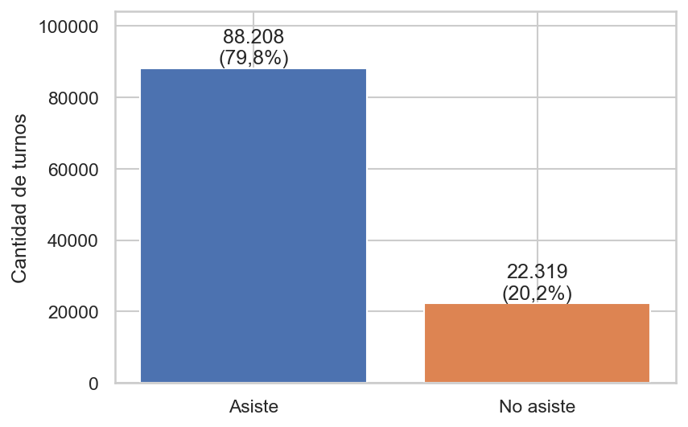

*Figura 1. El 79,8% de los turnos terminan en asistencia y el 20,2% en ausencia: una relación de 3,95 a 1.*

Para medir el efecto del desbalance sobre las métricas se evaluaron dos clasificadores que **no usan ningún atributo**, con validación cruzada estratificada de 5 particiones.

**Tabla 3.** Desempeño de clasificadores triviales.

| Clasificador | Exactitud | Exactitud balanceada | Recall (no-show) | F1 (no-show) | ROC-AUC | PR-AUC |
|---|---:|---:|---:|---:|---:|---:|
| Clase mayoritaria (siempre "asiste") | **0,798** | 0,500 | **0,000** | 0,000 | 0,500 | 0,202 |
| Aleatorio estratificado | 0,678 | 0,502 | 0,205 | 0,205 | 0,502 | 0,202 |

Un clasificador que **siempre predice "asiste" alcanza casi 80% de exactitud sin detectar ninguna ausencia**. La exactitud premia acertar la clase mayoritaria y oculta que el modelo no resuelve el problema. De este análisis se derivaron cuatro decisiones que guían el resto del trabajo:

1. **Métricas principales:** PR-AUC (área bajo la curva precisión-recall), ROC-AUC, recall y F1 de la clase *no-show*, y exactitud balanceada. La PR-AUC es la métrica principal porque se concentra en la clase minoritaria y es más informativa que la ROC-AUC con clases desbalanceadas (Saito y Rehmsmeier, 2015). Su piso sin información es la tasa de no-show (~0,20); el de la ROC-AUC es 0,5.
2. **Partición estratificada** por la variable objetivo.
3. **Comparación de estrategias de tratamiento del desbalance**, aplicadas solo sobre los datos de entrenamiento (sección 5.4).
4. **Ajuste explícito del umbral de decisión**, porque el umbral por defecto de 0,5 no es adecuado con clases desbalanceadas (sección 6.1).

### 3.5. Análisis univariado

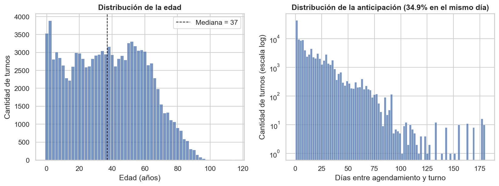

*Figura 2. La edad tiene una distribución amplia (de recién nacidos a mayores de 90 años). La anticipación es muy asimétrica: el 34,9% de los turnos se agenda para el mismo día, y unos pocos con más de 100 días.*

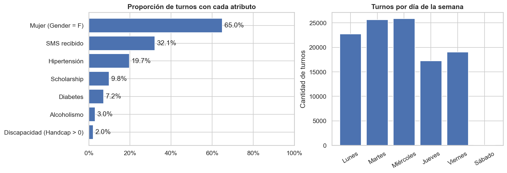

*Figura 3. Las condiciones clínicas (diabetes, alcoholismo, discapacidad) son poco frecuentes. Los turnos se concentran de lunes a viernes; el sábado es una categoría prácticamente vacía.*

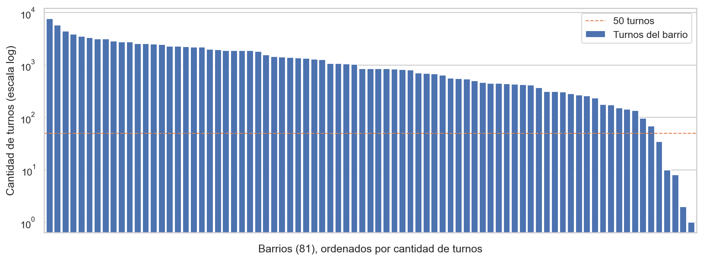

*Figura 4. Los 81 barrios tienen tamaños muy desiguales: los 5 más frecuentes concentran el 22,9% de los turnos, y 5 barrios tienen menos de 50.*

### 3.6. Relación de los atributos con el ausentismo

Para cada atributo se calculó la tasa de no-show por categoría con su intervalo de confianza del 95% (método de Wilson; Wilson, 1927).

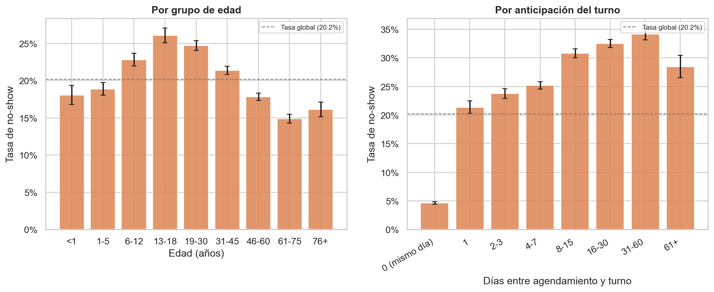

*Figura 5. La anticipación es el factor con la relación más fuerte: los turnos agendados para el mismo día casi no tienen ausencias (4,6%), mientras que con más de un día de anticipación la tasa sube al 28,5%. La edad tiene una relación no lineal: el máximo está entre 13 y 30 años (~25%) y el mínimo entre 61 y 75 (~15%).*

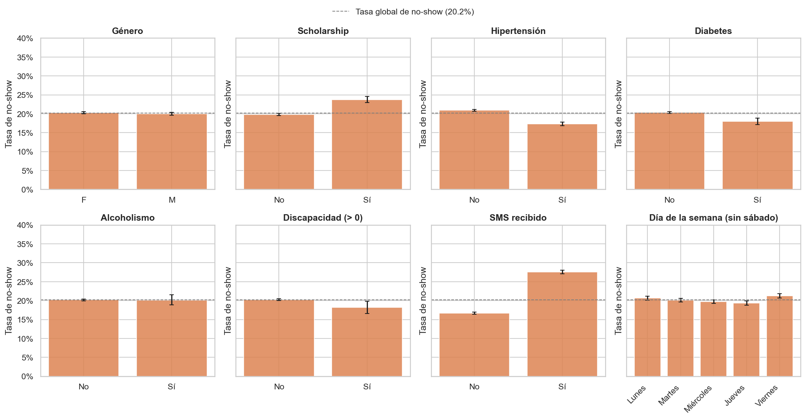

*Figura 6. Género, alcoholismo y discapacidad no muestran diferencias apreciables. Los turnos con SMS muestran **más** ausencias, un resultado contraintuitivo que se analiza más abajo.*

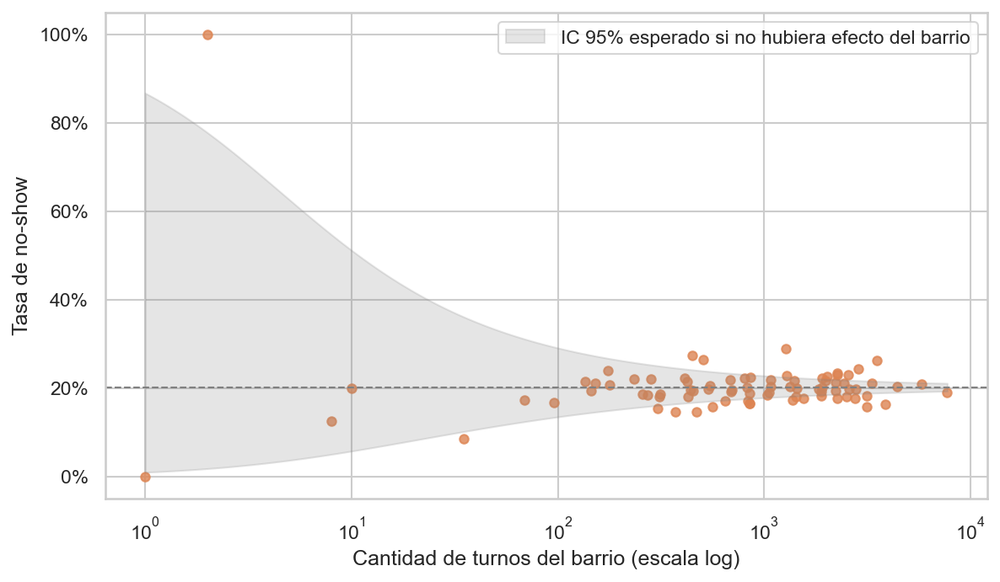

*Figura 7. La dispersión de los barrios chicos es ruido estadístico (cae dentro de la banda esperada sin efecto del barrio), pero 31 de los 81 barrios difieren significativamente de la tasa global: el barrio aporta señal.*

Con más de 100.000 registros casi cualquier diferencia resulta estadísticamente significativa. Por eso los atributos se ordenaron por el **tamaño del efecto** y no por el *p*-valor.

**Tabla 4.** Pruebas de asociación con la variable objetivo, ordenadas por tamaño del efecto.

| Atributo | Prueba | *p*-valor | Tamaño del efecto | Medida |
|---|---|---|---:|---|
| Anticipación | Mann-Whitney U | < 0,001 | **0,397** | Correlación biserial de rangos |
| SMS recibido | Chi-cuadrado | < 0,001 | 0,126 | V de Cramér |
| Edad | Mann-Whitney U | < 0,001 | −0,088 | Correlación biserial de rangos |
| Barrio | Chi-cuadrado | < 0,001 | 0,067 | V de Cramér |
| Hipertensión | Chi-cuadrado | < 0,001 | 0,036 | V de Cramér |
| Beca (Bolsa Família) | Chi-cuadrado | < 0,001 | 0,029 | V de Cramér |
| Día de la semana | Chi-cuadrado | < 0,001 | 0,016 | V de Cramér |
| Diabetes | Chi-cuadrado | < 0,001 | 0,015 | V de Cramér |
| Discapacidad | Chi-cuadrado | 0,134 | 0,008 | V de Cramér |
| Género | Chi-cuadrado | 0,173 | 0,004 | V de Cramér |
| Alcoholismo | Chi-cuadrado | 0,965 | 0,000 | V de Cramér |

La anticipación tiene un efecto **tres veces mayor** que el del atributo siguiente. Género, discapacidad y alcoholismo no tienen asociación significativa.

**El SMS como variable de confusión.** El resultado de la Figura 6 sugiere que el recordatorio por SMS *aumenta* el ausentismo, lo cual es contrario a lo esperado. La explicación está en la anticipación:

- ningún turno agendado para el mismo día recibe SMS;
- esos turnos son justamente los que casi nunca terminan en ausencia.

La anticipación es, por lo tanto, una **variable de confusión**. Al comparar dentro de cada tramo de anticipación, el resultado se invierte (Figura 8 y Tabla 5).

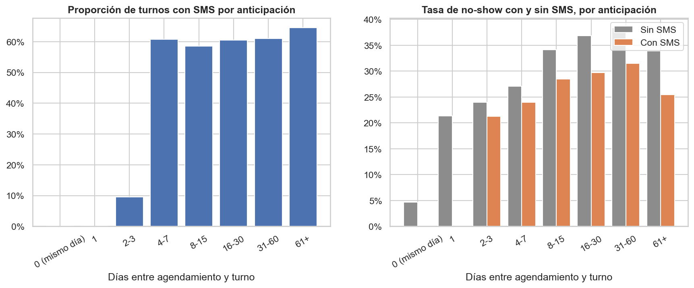

*Figura 8. A la izquierda, el SMS solo se envía a turnos con varios días de anticipación. A la derecha, dentro de cada tramo de anticipación los turnos con SMS tienen **menos** ausencias que los turnos sin SMS.*

**Tabla 5.** Tasa de no-show con y sin SMS, por tramo de anticipación.

| Anticipación (días) | Sin SMS | Con SMS |
|---|---:|---:|
| 2 a 3 | 24,0% | 21,3% |
| 4 a 7 | 27,1% | 24,0% |
| 8 a 15 | 34,1% | 28,5% |
| 16 a 30 | 36,8% | 29,7% |
| 31 a 60 | 38,4% | 31,5% |
| Más de 60 | 33,9% | 25,5% |

El efecto aparente del SMS era una paradoja de Simpson: en todos los tramos, el SMS se asocia con **menos** ausencias. Como los datos son observacionales, esto no prueba que el SMS *cause* la reducción, pero sí que la asociación global es engañosa. Esta distinción se retoma al interpretar el modelo.

### 3.7. Análisis temporal, por paciente y entre predictores

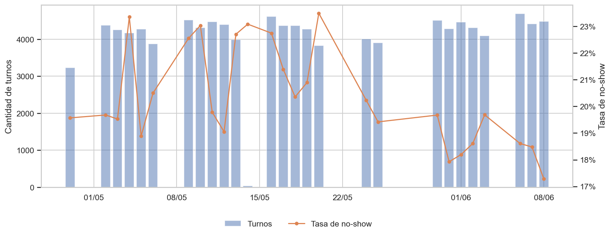

*Figura 9. El período abarca solo 27 días con turnos. La tasa diaria oscila sin una tendencia clara, por lo que no corresponde un análisis de estacionalidad.*

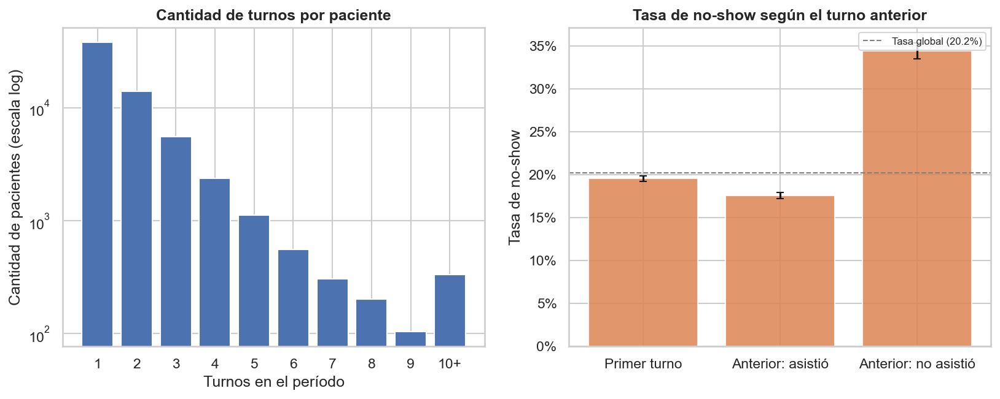

*Figura 10. Si el turno anterior del paciente terminó en ausencia, la tasa de no-show del turno siguiente es del 34,4%, contra 17,5% si asistió. (En la sección 4.2 se muestra que esta cifra está inflada por turnos del mismo día y se corrige.)*

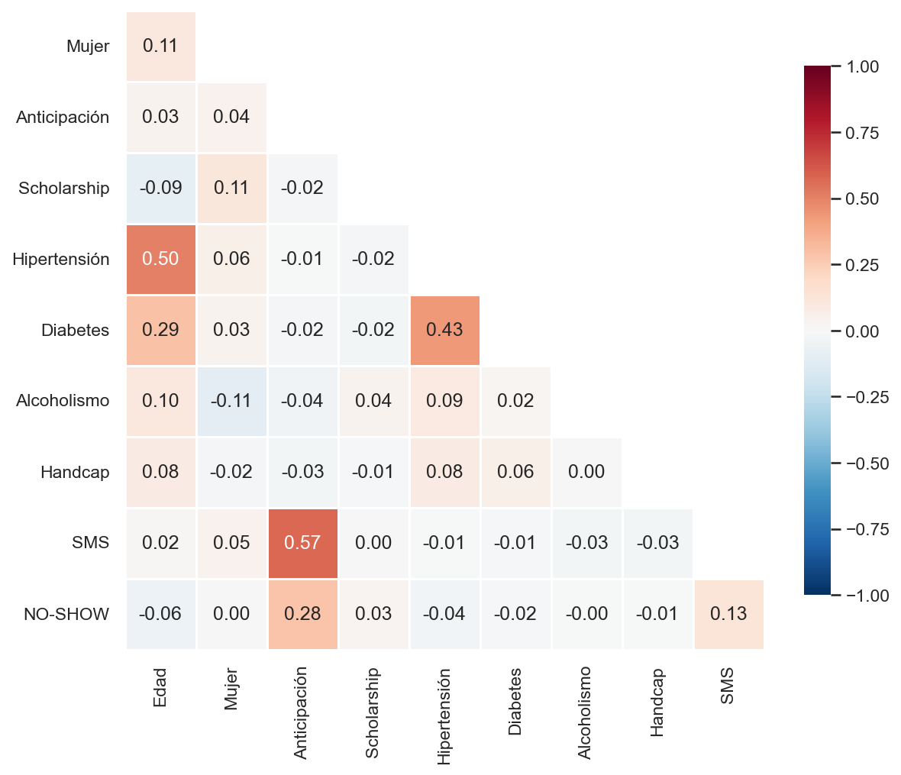

*Figura 11. Las correlaciones más altas aparecen entre la edad y la hipertensión, entre la hipertensión y la diabetes, y entre el SMS y la anticipación. Esta última es coherente con la confusión descrita en la sección 3.6. No hay redundancias que obliguen a eliminar atributos.*

### 3.8. Síntesis del análisis exploratorio

**Tabla 6.** Hallazgos del análisis exploratorio y decisiones que se derivan.

| Hallazgo | Decisión para la preparación y el modelado |
|---|---|
| Desbalance de clases (~4:1); un clasificador trivial logra ~80% de exactitud | PR-AUC como métrica principal; partición estratificada; estrategias de desbalance solo en entrenamiento; ajuste del umbral |
| La anticipación es el atributo más asociado al ausentismo | Construir `anticipacion_dias` y un indicador de turno en el mismo día |
| El efecto aparente del SMS está confundido con la anticipación | Conservar el atributo e interpretarlo siempre junto a la anticipación |
| El resultado del turno anterior se asocia con el actual | Construir atributos de historial usando solo días estrictamente anteriores |
| Pacientes con varios turnos el mismo día, mayormente con igual resultado | Partición **agrupada por paciente** |
| Período corto (27 días con turnos) | Descartar la partición temporal como estrategia principal |
| Pocas inconsistencias (edad, fechas) | Eliminar esas filas |
| `Handcap` es un conteo con valores altos muy raros | Binarizar |
| Barrios de tamaños muy desiguales, con señal | Codificación por objetivo dentro de la validación cruzada |
| Identificadores sin valor predictivo | Excluirlos como predictores; `PatientId` solo para agrupar |

---

## 4. Limpieza y preparación de los datos

La preparación aplica las tareas de la Unidad II del programa (Han et al., 2012; Hernández Orallo et al., 2004): **limpieza** (valores erróneos y anómalos), **reducción** (evaluación de la relevancia de los atributos) y **transformación** (normalización, discretización y codificación). No hubo integración de fuentes, porque el dataset es un único archivo.

### 4.1. Limpieza

Se eliminaron filas solo cuando el valor era imposible o inconsistente, porque son muy pocas y no hay forma confiable de corregirlas. No hubo valores faltantes que imputar.

**Tabla 7.** Registro de limpieza.

| Paso | Filas eliminadas | Filas restantes | Justificación |
|---|---:|---:|---|
| Edad negativa | 1 | 110.526 | Valor imposible |
| Edad mayor a 110 años | 5 | 110.521 | Valor implausible (115 años, repetido); se conserva 102 |
| Turno anterior al agendamiento | 5 | 110.516 | Un turno no puede agendarse después de ocurrir |

En total se eliminaron **11 filas (0,010%)** y la tasa de no-show no cambió (20,19%), por lo que la limpieza no introdujo sesgo. Además se aplicaron cuatro transformaciones:
- las columnas se renombraron al español, sin errores de escritura;
- la variable objetivo se codificó como 0/1;
- las fechas se convirtieron a tipo fecha;
- `discapacidad` se binarizó: los valores 2 a 4 representan el 0,18% de los turnos y el atributo no mostró asociación con el ausentismo.

Controles automáticos verifican después de la limpieza que todas las edades sean válidas, que no haya anticipaciones negativas y que no queden faltantes.

### 4.2. Ingeniería de atributos

Se construyeron nuevos atributos a partir de los originales. Todos se calculan **fila a fila o con información del pasado del paciente**, por lo que respetan el momento de la predicción definido en la sección 1.

**Tabla 8.** Atributos construidos.

| Grupo | Atributo | Definición | Justificación |
|---|---|---|---|
| Temporales | `anticipacion_dias` | Días entre el agendamiento y el turno | Atributo más asociado al ausentismo (efecto 0,40) |
| | `mismo_dia` | 1 si el turno se agendó para el mismo día | Captura el salto abrupto de la tasa (4,6% frente a 28,5%) |
| | `dia_semana` | Día del turno (0 = lunes … 4 = viernes; el sábado se agrupa con el viernes) | Leve asociación; el sábado tiene solo 39 turnos |
| | `hora_agenda` | Hora en que se agendó el turno | Información disponible al agendar (se explora en la Figura 12) |
| Demográficos | `mujer` | 1 si el género es femenino | Codificación binaria |
| | `grupo_edad` | Edad discretizada en 9 tramos con límites fijos | Relación no lineal con el ausentismo; se usa en el modelo lineal |
| Del paciente | `turnos_mismo_dia` | Turnos del paciente ese día | El 14,7% de los turnos pertenece a pacientes con varios turnos ese día |
| | `turnos_previos` | Turnos del paciente en días **estrictamente anteriores** | Historial |
| | `ausencias_previas` | Ausencias en esos turnos | Historial |
| | `tasa_ausencias_previas` | Ausencias previas / turnos previos (0 si no hay historial) | Historial normalizado |
| | `tiene_historial` | 1 si tiene al menos un turno previo | Distingue "sin historial" de "historial sin ausencias" |

La discretización de la edad usa límites fijos, definidos con criterio de dominio en el EDA y no aprendidos de los datos, por lo que no genera fuga de información.

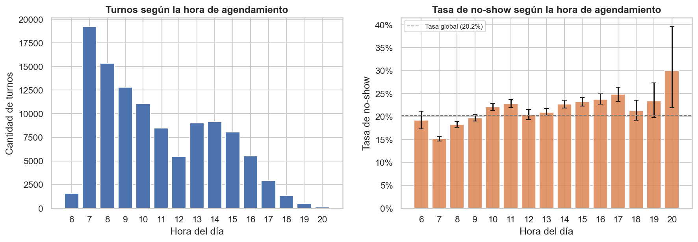

*Figura 12. La tasa de ausentismo varía con la hora de agendamiento, pero parte de esa variación se debe a la anticipación: entre los turnos agendados a las 7 y 8 h, alrededor del 43% son para el mismo día, frente a cerca del 19% de los agendados a las 6 h. El atributo se conserva y su aporte real se evalúa con la importancia por permutación (sección 6.4).*

**Historial del paciente sin fuga de información.** Los atributos de historial cuentan solo turnos de **días estrictamente anteriores**. Si se incluyeran turnos del mismo día, un turno podría "ver" el resultado de otro turno simultáneo, información que no existe al momento de predecir.

Esta definición corrigió un sesgo del análisis exploratorio. En la Figura 10, el "turno anterior" podía ser otro turno del mismo día, cuyo resultado está muy correlacionado con el actual, y eso inflaba el efecto (34,4% de ausentismo). Con la definición estricta, el efecto real es más moderado.

**Tabla 9.** Tasa de no-show según el historial del paciente (definición estricta).

| Historial | Turnos | Tasa de no-show (IC 95%) |
|---|---:|---|
| Sin historial | 66.286 | 19,4% (19,1% – 19,7%) |
| Historial sin ausencias | 30.119 | 18,8% (18,4% – 19,3%) |
| 1 ausencia previa | 10.472 | 25,0% (24,2% – 25,9%) |
| 2 o más ausencias previas | 3.639 | 32,1% (30,6% – 33,7%) |

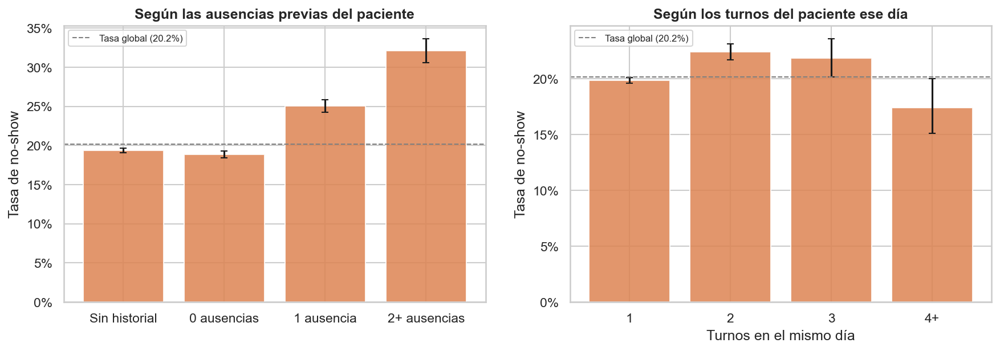

*Figura 13. Tener historial no cambia el riesgo; lo que lo aumenta es **acumular ausencias**. El atributo informativo es, por lo tanto, `ausencias_previas` y su tasa.*

La corrección del historial se verificó de dos formas:
- una implementación de fuerza bruta, que recorre turno por turno, coincidió en todos los casos;
- un control automático comprueba que ningún turno del primer día de un paciente tenga historial.

**Atributos excluidos.** Quedaron fuera del modelado:
- los identificadores, sin valor predictivo (`PatientId` se conserva solo para agrupar);
- las fechas absolutas, que no generalizan a otros períodos;
- la hora del turno, que no está disponible en los datos;
- la cantidad total de turnos del paciente en el período, porque usaría turnos futuros y produciría **fuga de información**.

### 4.3. Partición de los datos

Se usó una partición **80% entrenamiento / 20% prueba** que cumple dos condiciones simultáneas, implementadas con `StratifiedGroupKFold`:

- **Estratificada por la variable objetivo**, para que ambos conjuntos conserven la proporción de ausencias.
- **Agrupada por paciente**: todos los turnos de un paciente quedan del mismo lado. Si los turnos de un paciente se repartieran entre entrenamiento y prueba, el modelo podría "reconocer" al paciente y la evaluación resultaría optimista.

Dentro del entrenamiento se asignaron además **5 folds de validación cruzada** con el mismo criterio. Quedaron guardados en el dataset, de modo que **todos los modelos se comparan con exactamente las mismas particiones**.

**Tabla 10.** Partición de los datos.

| Conjunto | Turnos | Pacientes | Tasa de no-show |
|---|---:|---:|---:|
| Entrenamiento | 88.301 (79,9%) | 49.737 | 20,10% |
| Prueba | 22.215 (20,1%) | 12.559 | 20,55% |

Ningún paciente aparece en ambos conjuntos, y la tasa de no-show de los 5 folds varía apenas entre 19,55% y 20,32%.

**Alternativa descartada.** Una partición temporal reflejaría mejor el uso real del modelo, pero con solo 27 días de turnos el conjunto de prueba quedaría reducido a una semana. Esta limitación se retoma en las conclusiones.

**Uso del conjunto de prueba.** No se usó para explorar, ajustar ni seleccionar. Se evaluó **una única vez**, al final del trabajo (sección 6).

### 4.4. Relevancia de los atributos

Como paso de reducción de datos, se evaluó la relevancia de cada atributo con la **información mutua**, que mide cuánto se reduce la incertidumbre sobre el ausentismo al conocer el atributo y capta relaciones no lineales. Se calculó **solo con el conjunto de entrenamiento**.

El estimador de información mutua sobrestima la relevancia de los atributos con muchos valores distintos. Para comparar de forma justa se aplicó la **corrección de Miller-Madow** (Miller, 1955), que resta el sesgo esperado (k − 1)/(2N).

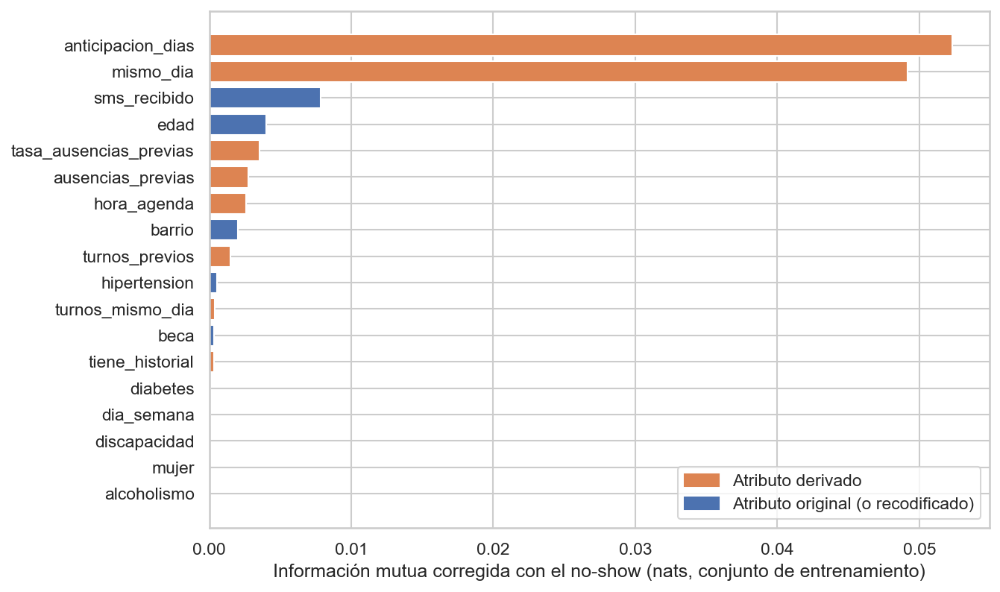

*Figura 14. Los atributos derivados (en naranja) ocupan los primeros lugares.*

La figura muestra tres resultados:
- **Anticipación:** los dos atributos derivados de la anticipación están muy por encima del resto.
- **Historial:** los atributos de historial superan al barrio y a todos los atributos clínicos originales.
- **Atributos sin señal:** alcoholismo, género, discapacidad y diabetes tienen relevancia prácticamente nula.

**Decisión: conservar todos los atributos.** Hubo tres razones:
1. La dimensionalidad ya es baja (18 atributos).
2. Una relevancia individual baja no descarta un aporte en interacción con otros atributos, algo que los ensambles de árboles pueden capturar.
3. El aporte real de cada atributo se mide después con la importancia por permutación sobre el modelo final (sección 6.4).

### 4.5. Preprocesamiento por familia de algoritmos

Los algoritmos tienen requisitos distintos, por lo que se definieron dos preprocesadores.

**Tabla 11.** Transformaciones por familia de algoritmos.

| Transformación | Árboles (Árbol, Random Forest, LightGBM, XGBoost) | Lineal (Regresión Logística) |
|---|---|---|
| Atributos numéricos | Sin cambios (los árboles no dependen de la escala) | Logaritmo (`log1p`) en atributos asimétricos y **estandarización** |
| Edad | Numérica | **Discretizada** en 9 tramos, con *one-hot* |
| Día de la semana | Ordinal (0 a 4) | *One-hot* |
| Barrio (81 categorías) | Codificación por objetivo | Codificación por objetivo y estandarización |
| Atributos binarios | Sin cambios | Sin cambios |
| **Columnas resultantes** | **18** | **28** |

**Codificación por objetivo del barrio** (Micci-Barreca, 2001). Reemplaza cada barrio por su tasa de no-show, suavizada hacia la tasa global cuando el barrio tiene pocos turnos. Se eligió frente a otras dos alternativas:
- el *one-hot*, que generaría 81 columnas dispersas;
- agrupar los barrios chicos, que perdería la señal detectada en la Figura 7.

Como la codificación usa la variable objetivo, la implementación (`TargetEncoder` de scikit-learn) aplica validación cruzada interna, para que ningún turno se codifique con su propio resultado.

**Regla contra la fuga de información.** Ningún preprocesador se ajustó sobre todos los datos. Todos forman parte de los *pipelines* de modelado, de modo que en cada fold se ajustan **solo con los datos de entrenamiento de ese fold**.

**Dataset final.** Tiene 110.516 turnos y 18 atributos de entrada, con la partición y los folds asignados. Se identifica con el *hash* SHA-256 `40d361e54c4cd001…`, que se verifica al inicio de cada notebook de modelado y se registra en cada corrida de MLflow.

---

## 5. Modelado, algoritmos y evaluación

### 5.1. Diseño experimental

| Elemento | Decisión |
|---|---|
| Datos | Solo el conjunto de entrenamiento (88.301 turnos). La prueba se reserva para la sección 6 |
| Validación | Validación cruzada (Tan et al., 2018) con los **5 folds fijos**. Como todos los modelos usan las mismas particiones, se pueden comparar fold a fold (comparación pareada) |
| *Pipeline* | Preprocesamiento → remuestreo (opcional) → clasificador, ajustado dentro de cada fold |
| Predicciones fuera de fold (OOF) | Cada turno de entrenamiento recibe la probabilidad de un modelo que no lo vio. Se usan para las curvas y para elegir el umbral |
| Métrica principal | PR-AUC, independiente del umbral |
| Métricas complementarias | ROC-AUC; recall, precisión y F1 de la clase *no-show*; exactitud balanceada y exactitud con umbral 0,5; Brier (calibración); PR-AUC de entrenamiento (diagnóstico de sobreajuste) |
| Registro | Cada configuración se registró en MLflow con sus parámetros, métricas, *hash* del dataset, semilla y *commit* de Git |

### 5.2. Algoritmos utilizados

Se compararon seis algoritmos. Además de los dos vistos en la materia (Árbol de Decisión y Regresión Logística, Unidad III), se incluyeron algoritmos de ensamble no vistos en clase, que se describen a continuación, según lo solicitado en el enunciado.

**Tabla 12.** Algoritmos comparados.

| Algoritmo | Descripción | Visto en la materia |
|---|---|---|
| Dummy (clase a priori) | Predice siempre la proporción de la clase mayoritaria. Es el piso de referencia | — |
| Regresión Logística | Modelo lineal que estima la probabilidad mediante la función logística. Interpretable y en general bien calibrado | Sí (Unidad III) |
| Árbol de Decisión | Particiona el espacio de atributos con reglas "si… entonces". Muy interpretable; sin poda tiende a sobreajustar | Sí (Unidad III) |
| Random Forest | Ensamble de árboles entrenados sobre muestras *bootstrap* y subconjuntos aleatorios de atributos (*bagging*). Reduce la varianza de un árbol individual (Breiman, 2001) | No |
| LightGBM | *Gradient boosting*: construye árboles en secuencia, cada uno corrigiendo los errores del anterior. Usa histogramas y crecimiento por hojas para ser muy eficiente (Ke et al., 2017) | No |
| XGBoost | *Gradient boosting* con regularización explícita de la complejidad de los árboles (Chen y Guestrin, 2016) | No |

**Técnicas complementarias no vistas en clase:**
- **SMOTE** (Chawla et al., 2002): genera ejemplos sintéticos de la clase minoritaria interpolando entre vecinos cercanos.
- **Optuna** (Akiba et al., 2019): optimiza hiperparámetros con un muestreador bayesiano (TPE) que concentra la búsqueda en las regiones prometedoras del espacio.
- **fANOVA** (Hutter et al., 2014): estima qué hiperparámetros explican la variación del desempeño.
- **Importancia por permutación** (Breiman, 2001): mide cuánto empeora un modelo al mezclar al azar los valores de un atributo.
- ***Bootstrap*** (Efron y Tibshirani, 1993): estima intervalos de confianza remuestreando los datos.

### 5.3. Experimento 1: modelos con parámetros por defecto

Todos los algoritmos se entrenaron con sus parámetros por defecto y sin tratamiento del desbalance. Este experimento establece la línea de base.

**Tabla 13.** Desempeño con parámetros por defecto (validación cruzada, 5 folds).

| Modelo | PR-AUC (media ± desvío) | ROC-AUC | Recall con umbral 0,5 | F1 con umbral óptimo | Brier |
|---|---:|---:|---:|---:|---:|
| **LightGBM** | **0,381 ± 0,014** | **0,744** | 0,038 | 0,457 | 0,142 |
| XGBoost | 0,366 ± 0,009 | 0,735 | 0,079 | 0,450 | 0,144 |
| Regresión Logística | 0,366 ± 0,015 | 0,736 | 0,030 | 0,451 | 0,143 |
| Random Forest | 0,354 ± 0,010 | 0,724 | 0,114 | 0,444 | 0,147 |
| Árbol de Decisión | 0,233 ± 0,005 | 0,567 | 0,326 | 0,335 | 0,289 |
| Dummy | 0,201 ± 0,003 | 0,500 | 0,000 | — | 0,161 |

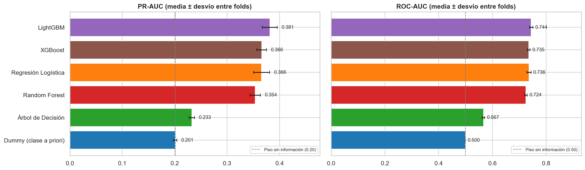

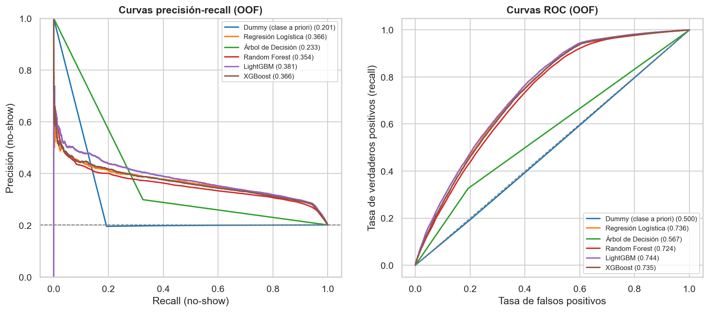

*Figuras 15 y 16. Todos los modelos superan al clasificador trivial. Los modelos de* boosting *y la Regresión Logística forman el grupo de mejor desempeño; el Árbol de Decisión sin poda queda apenas por encima del piso.*

**Diagnóstico de sobreajuste.** Se comparó la PR-AUC sobre los datos de entrenamiento de cada fold con la de validación.

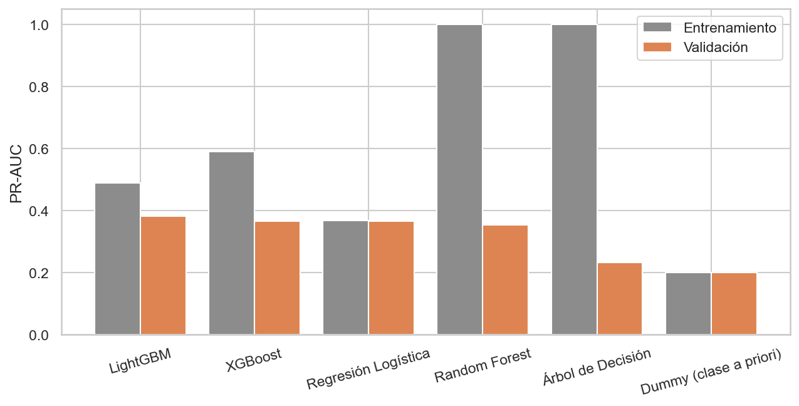

**Tabla 14.** Brecha de sobreajuste (PR-AUC de entrenamiento − PR-AUC de validación).

| Modelo | Entrenamiento | Validación | Brecha |
|---|---:|---:|---:|
| Árbol de Decisión | 1,000 | 0,233 | **0,767** |
| Random Forest | 1,000 | 0,354 | **0,646** |
| XGBoost | 0,591 | 0,366 | 0,225 |
| LightGBM | 0,490 | 0,381 | 0,108 |
| Regresión Logística | 0,368 | 0,366 | 0,002 |

**Lectura del experimento 1:**

- **El desbalance se ve en el recall.** Con umbral 0,5 el recall de los mejores modelos es menor al 8%: al entrenar con la distribución original, las probabilidades rara vez superan 0,5. Esto confirma que la PR-AUC, independiente del umbral, es la métrica adecuada para comparar modelos.
- **Los árboles sin límite memorizan el entrenamiento.** El Árbol de Decisión y Random Forest alcanzan una PR-AUC de entrenamiento de 1,0. Random Forest generaliza mucho mejor que el árbol individual gracias al promedio de muchos árboles, pero ambos casos justifican optimizar los hiperparámetros que regulan la complejidad.
- **La Regresión Logística prácticamente no sobreajusta**, y los modelos de *boosting* se ubican en un punto intermedio.

**Detalle técnico detectado durante el trabajo.** El `TargetEncoder` codifica el barrio de dos maneras: con validación cruzada interna al ajustarse y con las tasas de todo el entrenamiento al predecir. Si la PR-AUC de entrenamiento se mide con la segunda codificación, los árboles reciben valores distintos de los que usaron para aprender sus cortes, y el sobreajuste queda **subestimado**. La primera versión del diagnóstico tenía este problema: el árbol sin poda mostraba una PR-AUC de entrenamiento de solo 0,55, lo que llevó a atribuir erróneamente la diferencia a ruido en los datos. Se investigó la causa y se corrigió: la PR-AUC de entrenamiento se calcula ahora con la codificación de ajuste. Una vez corregido, el árbol alcanza 1,0, y solo el 0,3% de los turnos tiene atributos idénticos con resultados distintos.

### 5.4. Experimento 2: tratamiento del desbalance de clases

Cada modelo se reentrenó con tres estrategias, aplicadas **solo sobre los datos de entrenamiento de cada fold**:
- **Ponderación de clases:** los errores sobre la clase minoritaria pesan más en la función de pérdida.
- **Submuestreo aleatorio:** se eliminan turnos de la clase mayoritaria hasta igualar las clases.
- **SMOTE:** se generan turnos sintéticos de la clase minoritaria.

La variante "sin tratamiento" se tomó del experimento 1. Como los folds son idénticos, cada estrategia se comparó **fold a fold** contra esa variante.

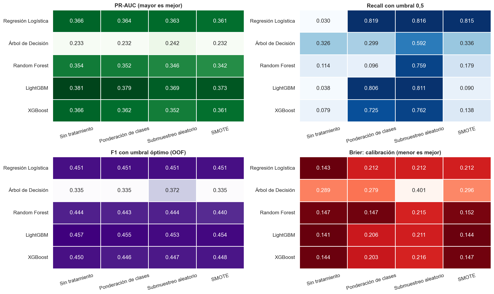

*Figura 18. Las estrategias apenas modifican la PR-AUC (arriba a la izquierda) y el F1 con umbral óptimo (abajo a la izquierda), pero cambian mucho el recall con umbral 0,5 (arriba a la derecha) y empeoran la calibración (abajo a la derecha).*

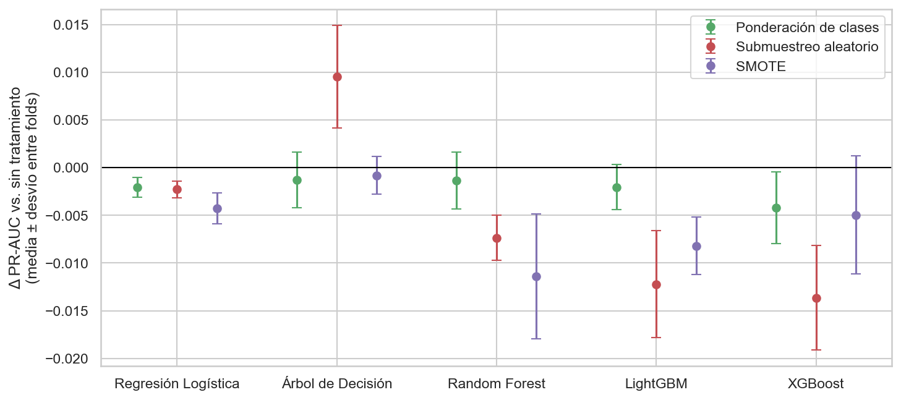

**Tabla 15.** Efecto promedio de cada estrategia respecto de "sin tratamiento" (promedio de los cinco modelos).

| Estrategia | Δ PR-AUC | Δ Recall con umbral 0,5 | Δ Brier | Tiempo relativo |
|---|---:|---:|---:|---:|
| Ponderación de clases | −0,002 | +0,43 | +0,036 | 1,0× |
| Submuestreo aleatorio | −0,005 | +0,63 | +0,078 | 0,6× |
| SMOTE | −0,006 | +0,19 | +0,017 | 2,6× |

**Tabla 16.** Ejemplo con LightGBM: el F1 alcanzable es el mismo con cualquier estrategia.

| Estrategia | PR-AUC | Recall con umbral 0,5 | Umbral óptimo (F1) | F1 con umbral óptimo |
|---|---:|---:|---:|---:|
| Sin tratamiento | 0,381 | 0,04 | 0,22 | 0,457 |
| Ponderación de clases | 0,379 | 0,81 | 0,52 | 0,455 |
| SMOTE | 0,373 | 0,09 | 0,25 | 0,454 |
| Submuestreo aleatorio | 0,369 | 0,81 | 0,53 | 0,453 |

**Lectura del experimento 2:**

- **Ninguna estrategia mejora la capacidad de ordenar los turnos por riesgo.** En Regresión Logística, Random Forest, LightGBM y XGBoost, las tres estrategias **reducen** levemente la PR-AUC, en la mayoría de los casos en todos o casi todos los folds. La Regresión Logística empeora en los 5 folds con cualquiera de las tres.
- **Las estrategias solo desplazan las probabilidades.** El recall con umbral 0,5 aumenta mucho con ponderación y con submuestreo, pero el umbral que maximiza el F1 pasa de ~0,22 a ~0,52, y el F1 alcanzable queda prácticamente igual (Tabla 16). El efecto equivale a **bajar el umbral de decisión**.
- **La calibración empeora** con ponderación y submuestreo: las probabilidades dejan de representar la frecuencia real del ausentismo.

**Por qué SMOTE no funciona en este problema.** SMOTE casi no modificó el recall de los modelos de árboles, a diferencia de lo que ocurrió con la Regresión Logística. La hipótesis fue que los árboles aprenden a reconocer los turnos sintéticos, porque SMOTE interpola valores en atributos que solo pueden ser enteros o binarios. Se verificó con el fold 0.

**Tabla 17.** Evidencia sobre SMOTE (LightGBM, fold 0 como validación).

| Indicador | Valor |
|---|---:|
| Turnos sintéticos con valores imposibles en atributos enteros o binarios (por ejemplo, `diabetes = 0,4`) | **98,6%** |
| ROC-AUC de un clasificador que distingue turnos sintéticos de positivos reales | **0,996** |
| Probabilidad media que LightGBM entrenado con SMOTE asigna a los turnos sintéticos | 0,94 |
| Probabilidad media que asigna a los positivos reales | 0,35 |
| Turnos de validación con probabilidad > 0,5 (sin tratamiento / SMOTE / SMOTE con enteros redondeados) | 1,6% / 3,9% / 47,6% |

La hipótesis se confirmó: el modelo aprende la **firma artificial** de SMOTE en lugar del patrón de ausentismo. Al redondear los atributos enteros, la firma desaparece y las probabilidades se desplazan como ocurre con la ponderación de clases. Es una demostración empírica de una limitación conocida de SMOTE con atributos discretos.

**Excepción.** El Árbol de Decisión con submuestreo mejoró de forma pequeña pero consistente: +0,010 de PR-AUC, en los 5 folds. Se probó si se debía a una reducción del sobreajuste o al criterio de partición, y ninguna explicación se confirmó. En la optimización (sección 5.5), esta ventaja desapareció al regularizar el árbol.

**Conclusión del experimento 2.** En este problema, el desbalance de clases afecta a la **elección del umbral de decisión**, no a la capacidad de discriminación de los modelos. Esta conclusión responde a la recomendación recibida en la propuesta. El desbalance se analizó antes de entrenar, se cuantificó su efecto sobre las métricas y se comprobó que la forma adecuada de tratarlo es:
1. seleccionar modelos con una métrica independiente del umbral (PR-AUC);
2. ajustar el umbral explícitamente con datos de validación (sección 6.1).

**Selección de candidatos.** Pasaron a la etapa de optimización los tres algoritmos con mejor PR-AUC (LightGBM, XGBoost y Regresión Logística). Se sumó el Árbol de Decisión como **referencia interpretable**.

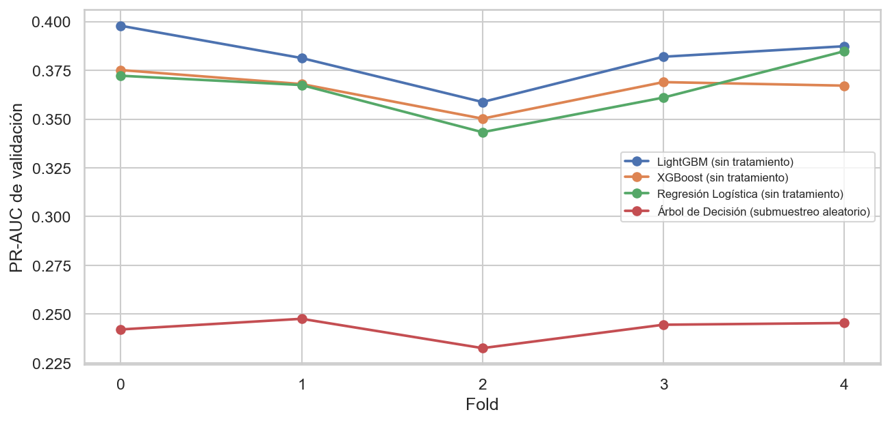

*Figura 20. LightGBM supera a XGBoost y a la Regresión Logística en los 5 folds.*

### 5.5. Optimización de hiperparámetros con Optuna

**Tabla 18.** Protocolo de optimización.

| Elemento | Configuración |
|---|---|
| Función objetivo | PR-AUC media en los 5 folds fijos de entrenamiento |
| Muestreador | TPE (*Tree-structured Parzen Estimator*) con semilla fija |
| Presupuesto | 60 *trials* por modelo, igual para todos |
| Poda | `MedianPruner`: tras cada fold se compara la PR-AUC parcial con la mediana de los *trials* anteriores; si es peor, el *trial* se interrumpe |
| Punto de partida | El primer *trial* de cada estudio es la configuración por defecto, para que el resultado optimizado no pueda quedar por debajo del baseline |
| Estrategia de desbalance | Hiperparámetro: "sin tratamiento" o "ponderación de clases" (más submuestreo para el árbol) |
| Registro | Una corrida de MLflow por estudio y una corrida anidada por cada *trial* (4 estudios y 240 *trials*) |

Los espacios de búsqueda incluyen los valores por defecto y se centran en los hiperparámetros que controlan la complejidad, que fue la principal fuente de sobreajuste en el experimento 1. El detalle completo está en el Anexo D.

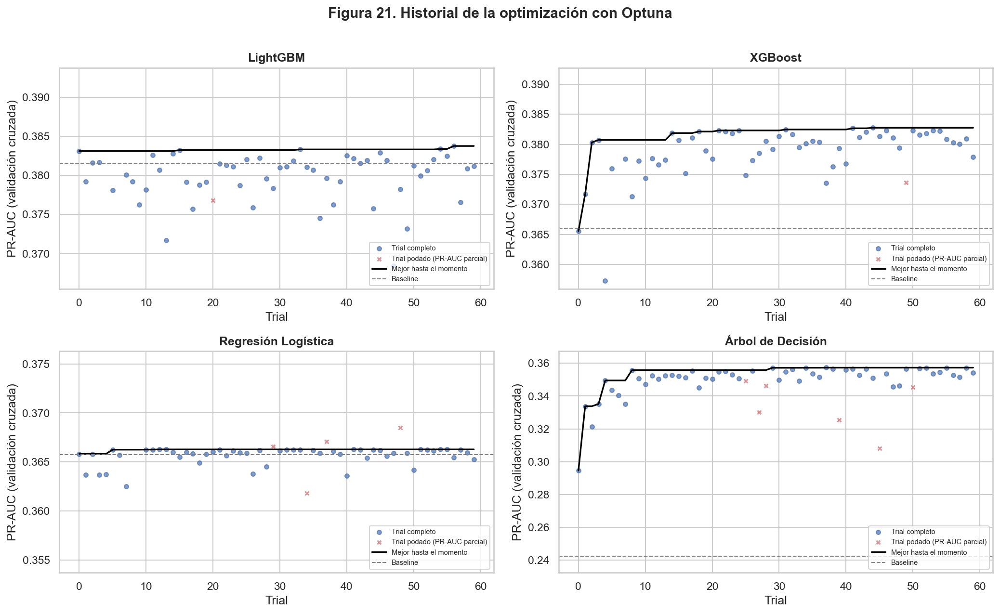

*Figura 21. En XGBoost y en el árbol la búsqueda mejora mucho sobre el baseline (línea punteada) y luego se estabiliza. En LightGBM y en la Regresión Logística el punto de partida ya está cerca del máximo alcanzado.*

**Importancia de los hiperparámetros.** Se estimó con fANOVA. Como el método ajusta internamente un *random forest*, su resultado depende de una semilla aleatoria. Al comparar dos ejecuciones completas del proyecto se detectó que estas importancias variaban, aunque los *trials* eran idénticos. Para que fueran reproducibles, se calcularon como la **media de 10 semillas fijas**, y la Figura 22 muestra además su desvío.

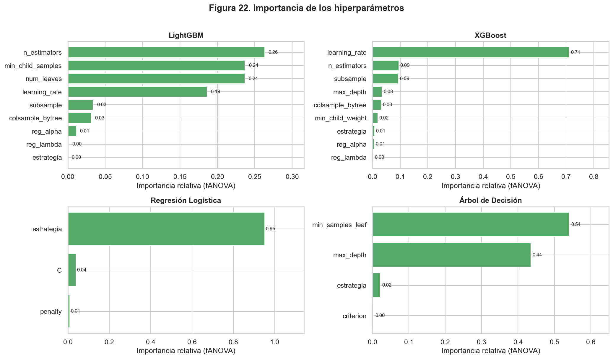

**Tabla 19.** Importancia de los hiperparámetros (fANOVA, media de 10 semillas).

| Modelo | Hiperparámetros más importantes | Estrategia de desbalance |
|---|---|---:|
| LightGBM | `learning_rate` 0,26 · `num_leaves` 0,22 · `n_estimators` 0,22 · `min_child_samples` 0,20 | 0,003 |
| XGBoost | `learning_rate` 0,73 | 0,012 |
| Árbol de Decisión | `max_depth` 0,52 · `min_samples_leaf` 0,45 | 0,030 |
| Regresión Logística | `estrategia` 0,94 (sobre una variación total muy pequeña) · `C` 0,04 | — |

**Tabla 20.** Baseline frente a modelo optimizado (validación cruzada).

| Modelo | PR-AUC baseline | PR-AUC optimizado | Δ (folds con mejora) | Brecha de sobreajuste (baseline → optimizado) |
|---|---:|---:|---|---|
| LightGBM | 0,381 | **0,384** | +0,002 (5/5) | 0,108 → 0,089 |
| XGBoost | 0,366 | 0,383 | +0,017 (5/5) | 0,225 → 0,071 |
| Regresión Logística | 0,366 | 0,366 | +0,001 (4/5) | 0,002 → 0,002 |
| Árbol de Decisión | 0,242 | 0,357 | +0,115 (5/5) | 0,220 → 0,023 |

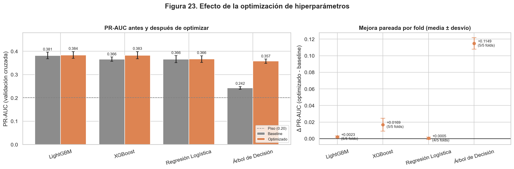

**Lectura de la optimización:**

- **Los dos modelos de *boosting* convergen al mismo techo.** Optimizados por separado, LightGBM y XGBoost llegan a una PR-AUC de ~0,383. Es una señal de que **el límite está en la información que contienen los atributos, no en los hiperparámetros**.
- **LightGBM ya estaba cerca de su óptimo** con los parámetros por defecto. XGBoost mejoró gracias a una tasa de aprendizaje baja (0,011) con más árboles.
- **La Regresión Logística está saturada.** Con 60 *trials*, todos los resultados quedan entre 0,362 y 0,367: su límite es la capacidad del modelo lineal, no su regularización.
- **El Árbol de Decisión fue el más beneficiado.** Pasó de 0,242 a 0,357 al regularizar su tamaño (`min_samples_leaf` = 364). Con el árbol bien regularizado, Optuna eligió "sin tratamiento": la ventaja del submuestreo observada en el experimento 2 desaparece.
- **La estrategia de desbalance es irrelevante en los modelos de *boosting*** (importancias de 0,003 y 0,012), y los cuatro mejores *trials* son "sin tratamiento". Es evidencia independiente que respalda la conclusión del experimento 2.
- **La optimización redujo el sobreajuste** de todos los modelos de árboles.

### 5.6. Selección del modelo final

**Criterio, definido antes de ver los resultados.** Para cada modelo se toma su mejor versión, optimizada o baseline, y se selecciona la de **mayor PR-AUC media en validación cruzada**.

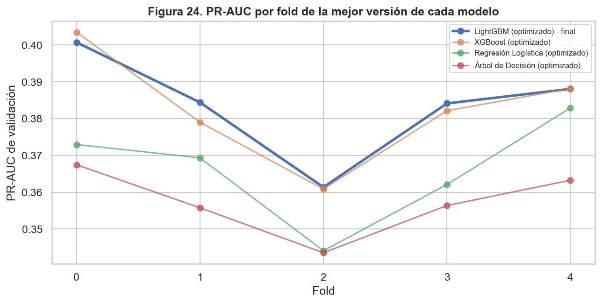

**Tabla 21.** Comparación de los dos mejores modelos.

| Indicador | LightGBM optimizado | XGBoost optimizado |
|---|---:|---:|
| PR-AUC (media ± desvío) | **0,3837 ± 0,0142** | 0,3827 ± 0,0154 |
| ROC-AUC | 0,745 | 0,745 |
| F1 con umbral óptimo | 0,457 | 0,458 |
| Brier | 0,141 | 0,141 |
| Folds en que LightGBM es mejor | 3 de 5 | — |
| Árboles del modelo | 108 | 384 |
| Tiempo de entrenamiento (5 folds) | 2,2 s | 5,8 s |

**Modelo seleccionado: LightGBM optimizado.** La diferencia con XGBoost (+0,001) está dentro de la variabilidad entre folds, por lo que es un **empate técnico**, y así se informa. Se mantuvo LightGBM por dos motivos:
1. Cumple el criterio definido de antemano. Cambiar el criterio después de ver los resultados para favorecer a otro modelo sería un ajuste *a posteriori*.
2. Ante un desempeño equivalente, es el modelo más simple: menos de un tercio de los árboles y menos de la mitad del tiempo de entrenamiento.

**Configuración final:** `n_estimators` = 108, `learning_rate` = 0,052, `num_leaves` = 50, `min_child_samples` = 22, `subsample` = 0,918, `colsample_bytree` = 0,953, `reg_alpha` = 0,020 y `reg_lambda` = 3,94, sin tratamiento del desbalance.

**Sesgo de selección.** Elegir el mejor entre muchos *trials* evaluados con los mismos folds hace que su PR-AUC de validación cruzada sea una estimación levemente optimista. Por eso el desempeño definitivo se mide en el conjunto de prueba, que no participó de ninguna decisión.

---

## 6. Resultados obtenidos

Esta sección presenta el desempeño del modelo final y su interpretación. **El conjunto de prueba se utilizó una única vez**, con modelos y criterios definidos de antemano.

### 6.1. Ajuste del umbral de decisión

El umbral se eligió con las **predicciones fuera de fold del entrenamiento**, nunca con la prueba. Cada turno recibe la probabilidad de un modelo que no lo vio, de modo que el umbral se ajusta sobre datos "no vistos" sin comprometer la evaluación final.

El umbral adecuado depende del uso que el centro de salud haga del modelo. Por eso se analizaron varios puntos de operación.

**Tabla 22.** Puntos de operación del modelo final (predicciones fuera de fold del entrenamiento).

| Punto de operación | Umbral | Recall | Precisión | F1 | Turnos alertados |
|---|---:|---:|---:|---:|---:|
| **Máximo F1 (criterio principal)** | **0,230** | **0,741** | **0,330** | **0,457** | 45,1% |
| Recall mínimo del 70% | 0,242 | 0,700 | 0,336 | 0,454 | 41,8% |
| Recall mínimo del 50% | 0,298 | 0,500 | 0,371 | 0,426 | 27,1% |
| Capacidad: contactar al 20% de los turnos | 0,325 | 0,388 | 0,390 | 0,389 | 20,0% |
| Umbral por defecto | 0,500 | 0,033 | 0,558 | 0,062 | — |

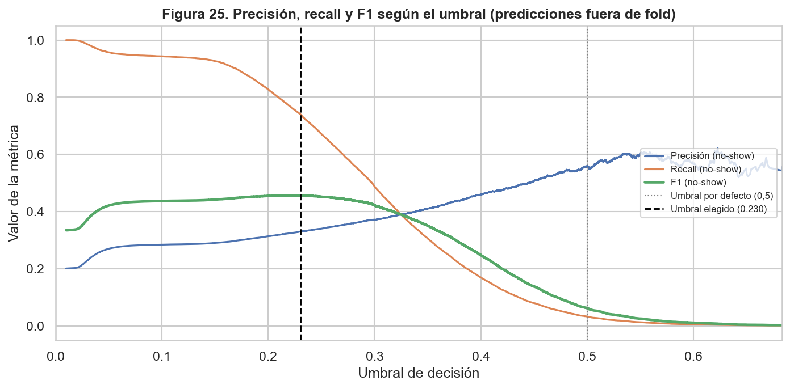

*Figura 25. Con el umbral por defecto de 0,5 el modelo casi nunca predice "no asiste" (recall 3,3%). Al bajarlo hasta el máximo F1 (0,230), el recall sube al 74% a cambio de una precisión menor.*

Se adoptó el **máximo F1** como umbral principal porque no supone una capacidad operativa ni un costo relativo de los errores que el trabajo no conoce. Este ajuste es el que **reemplaza al remuestreo de los datos** como forma de tratar el desbalance, tal como se fundamentó en la sección 5.4.

### 6.2. Evaluación en el conjunto de prueba

Se evaluaron cinco modelos, todos definidos antes de mirar la prueba. Cada uno se entrenó con todo el conjunto de entrenamiento y su umbral se eligió con el mismo criterio (máximo F1 en sus predicciones fuera de fold). Los intervalos de confianza del 95% se obtuvieron con **1.000 réplicas de *bootstrap* por paciente**: en cada réplica se remuestrean pacientes, no turnos, porque los turnos de un mismo paciente no son independientes.

**Tabla 23.** Desempeño en el conjunto de prueba (22.215 turnos), con IC 95%.

| Modelo | PR-AUC | ROC-AUC | Recall | Precisión | F1 | Brier |
|---|---|---|---:|---:|---:|---:|
| **LightGBM optimizado (final)** | **0,388 (0,369 – 0,406)** | **0,741 (0,732 – 0,749)** | **0,745** | **0,330** | **0,457** | **0,144** |
| LightGBM por defecto | 0,384 (0,367 – 0,404) | 0,739 (0,730 – 0,747) | 0,775 | 0,323 | 0,456 | 0,144 |
| Árbol de Decisión optimizado | 0,360 (0,347 – 0,374) | 0,725 (0,717 – 0,733) | 0,767 | 0,312 | 0,444 | 0,147 |
| Árbol de Decisión (profundidad 3) | 0,324 (0,313 – 0,335) | 0,710 (0,702 – 0,719) | 0,924 | 0,286 | 0,437 | 0,148 |
| Dummy (clase a priori) | 0,206 | 0,500 | 0,000 | 0,000 | 0,000 | 0,163 |

**Tabla 24.** Diferencias pareadas de PR-AUC en prueba (*bootstrap* por paciente).

| Comparación | Δ PR-AUC | IC 95% | Réplicas en que el final es mejor | ¿Diferencia consistente? |
|---|---:|---|---:|---|
| Final − LightGBM por defecto | +0,003 | −0,0002 a +0,0075 | 96,1% | No |
| Final − Árbol optimizado | +0,028 | +0,017 a +0,039 | 100% | Sí |
| Final − Árbol de profundidad 3 | +0,064 | +0,050 a +0,078 | 100% | Sí |

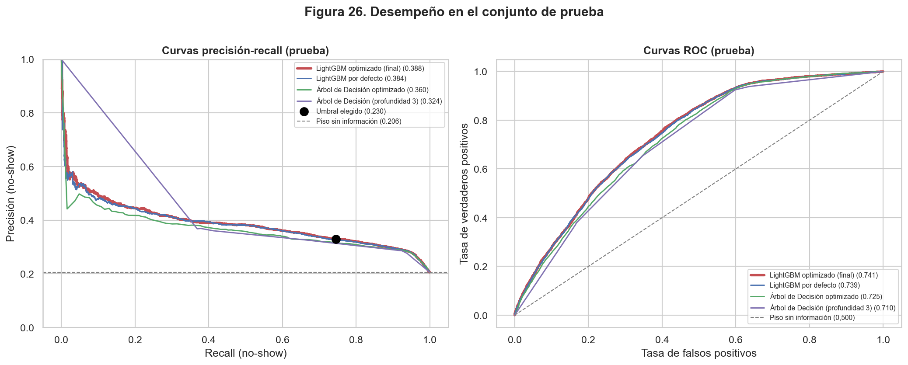

*Figura 26. Curvas precisión-recall y ROC en prueba. El punto negro marca el umbral elegido.*

**El modelo generaliza.** La PR-AUC de prueba (0,388) es levemente **mayor** que la de validación cruzada (0,384), algo que a primera vista sorprende. La explicación es la prevalencia: la PR-AUC depende de la proporción de positivos, que en prueba es del 20,55% y en entrenamiento del 20,10%. El propio clasificador trivial sube en la misma magnitud (+0,0046). Al dividir la PR-AUC por la prevalencia, el modelo rinde **1,91 veces el azar en validación cruzada y 1,89 veces en prueba**, prácticamente lo mismo. La ROC-AUC, que no depende de la prevalencia, se mantiene en el mismo nivel (0,745 en validación cruzada y 0,741 en prueba). No hay evidencia de sobreajuste ni de un sesgo de selección apreciable.

**La optimización aportó poco frente a la versión por defecto.** La diferencia con LightGBM por defecto (+0,003) tiene un intervalo que incluye el cero. Es coherente con la sección 5.5: LightGBM ya estaba cerca de su techo. La ventaja sobre los árboles, en cambio, es clara y estadísticamente consistente.

### 6.3. Desempeño operativo

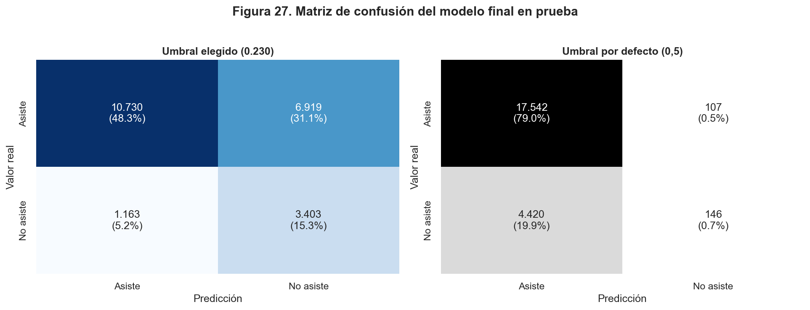

*Figura 27. A la izquierda, con el umbral elegido (0,230); a la derecha, con el umbral por defecto (0,5), que casi no detecta ausencias.*

**Tabla 25.** Impacto operativo del modelo final con el umbral elegido, cada 1.000 turnos.

| Concepto | Cada 1.000 turnos |
|---|---:|
| Ausencias reales | 206 |
| Turnos alertados como riesgo | 465 |
| Ausencias detectadas (verdaderos positivos) | 153 |
| Falsas alarmas (el paciente asiste pese a la alerta) | 311 |
| Ausencias no detectadas (falsos negativos) | 52 |

Con el umbral de máximo F1, el modelo detecta 3 de cada 4 ausencias, pero alerta casi la mitad de los turnos. Para un centro con recursos de contacto limitados, una forma más útil de usar el modelo es **contactar solo a los turnos de mayor riesgo**, según la capacidad disponible.

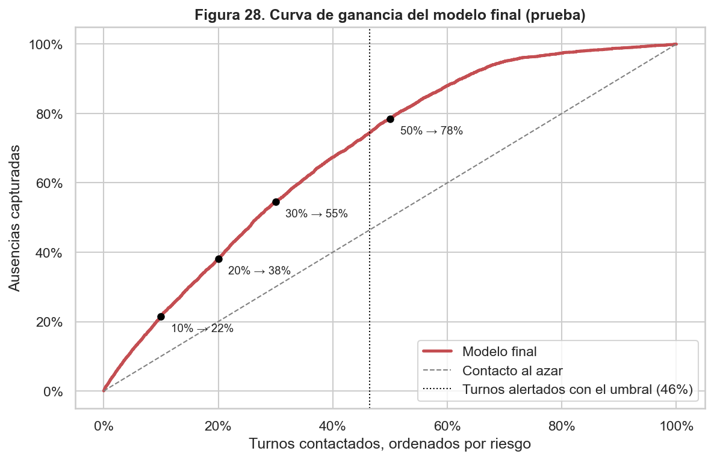

**Tabla 26.** Curva de ganancia en prueba.

| Turnos contactados (los de mayor riesgo) | Ausencias capturadas | Rendimiento frente al azar (*lift*) |
|---|---:|---:|
| 10% | 21,5% | 2,15× |
| 20% | 38,1% | 1,91× |
| 30% | 54,6% | 1,82× |
| 50% | 78,5% | 1,57× |

Contactar al 10% de los turnos de mayor riesgo captura el **doble** de ausencias que contactar al azar, y contactar al 30% captura más de la mitad.

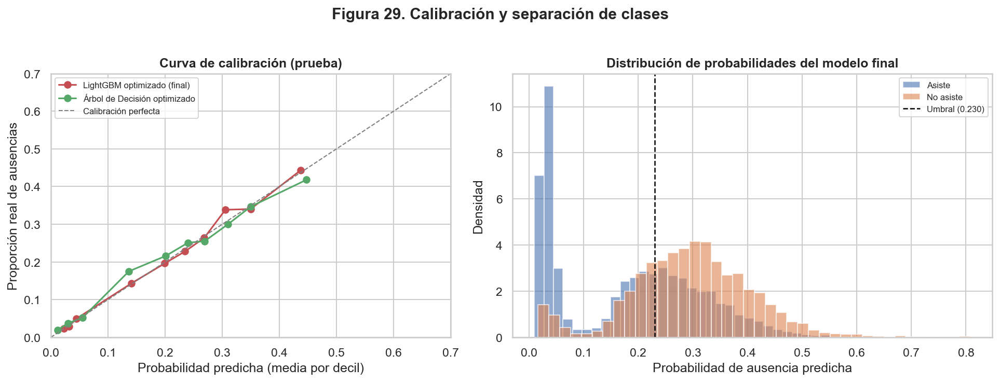

*Figura 29. La curva de calibración del modelo final sigue la diagonal: cuando el modelo predice un 30% de riesgo, falta aproximadamente el 30% de esos pacientes.*

**Las probabilidades están bien calibradas** (Brier 0,144, frente a 0,163 del clasificador trivial). Esto tiene un uso práctico concreto: sumando las probabilidades de los turnos de un día se obtiene una estimación de **cuántas ausencias esperar**, útil para planificar sobreturnos.

### 6.4. Factores que explican el ausentismo

Se usó la **importancia por permutación**: para cada atributo se mezclan sus valores en el conjunto de prueba y se mide cuánto cae la PR-AUC del modelo final. Se repitió 10 veces por atributo. Además de la importancia individual, se calculó la importancia **por grupos de atributos**, permutando juntos los atributos relacionados.

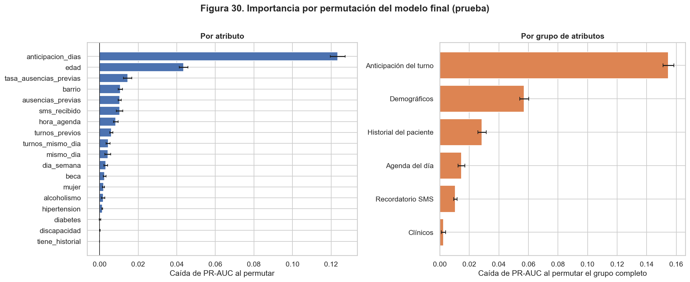

**Tabla 27.** Importancia por grupos de atributos (caída de PR-AUC al permutar el grupo).

| Grupo | Atributos | Caída de PR-AUC |
|---|---|---:|
| Anticipación del turno | `anticipacion_dias`, `mismo_dia` | **0,155** |
| Demográficos | `edad`, `mujer`, `barrio`, `beca` | 0,057 |
| Historial del paciente | `turnos_previos`, `ausencias_previas`, `tasa_ausencias_previas`, `tiene_historial` | 0,029 |
| Agenda del día | `turnos_mismo_dia`, `dia_semana`, `hora_agenda` | 0,015 |
| Recordatorio SMS | `sms_recibido` | 0,011 |
| Condiciones clínicas | `hipertension`, `diabetes`, `alcoholismo`, `discapacidad` | 0,003 |

**Por qué se analiza por grupos.** Cuando dos atributos contienen la misma información, la importancia individual se distorsiona. `mismo_dia` es exactamente `anticipacion_dias = 0`: al permutar uno solo, el modelo se apoya en el otro. Por eso `mismo_dia` aparece con importancia individual casi nula (0,004), aunque en el análisis exploratorio era uno de los atributos más asociados al ausentismo. Permutados juntos, los dos atributos pesan un 21% **más** que la suma de sus importancias individuales. La importancia por grupos es, por lo tanto, la medida más confiable.

**Coherencia entre análisis independientes.** Tres análisis distintos llegan al mismo ordenamiento:
- las pruebas de asociación del EDA (Tabla 4);
- la información mutua de la preparación (Figura 14);
- la importancia por permutación sobre el modelo final.

En los tres, la anticipación es dominante, la edad y el historial ocupan un segundo plano y las condiciones clínicas casi no aportan. Dentro del grupo demográfico, el peso corresponde casi por completo a la **edad** (0,044 de importancia individual).

**Sobre el SMS.** El recordatorio aporta información al modelo (0,011), pero esto **no prueba que el SMS reduzca el ausentismo**. Con datos observacionales, el modelo aprende asociaciones, no efectos causales. La sección 3.6 mostró que la asociación global era engañosa y que, dentro de cada tramo de anticipación, el SMS se asocia con menos ausencias.

### 6.5. Reglas interpretables

El árbol optimizado tiene hasta 18 niveles: es preciso, pero sus reglas no se pueden leer. Para explicar los patrones se entrenó un **árbol de profundidad 3**, con como máximo 8 reglas. Su costo en desempeño es una PR-AUC de 0,324 frente a 0,388 del modelo final.

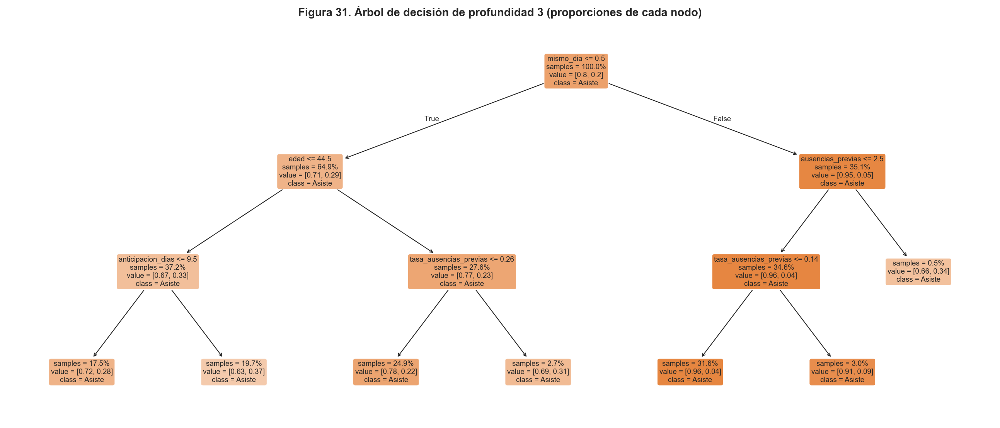

**Tabla 28.** Reglas del árbol de profundidad 3, ordenadas por tasa de no-show.

| N.º | Regla | Turnos en prueba | No-show (entrenamiento) | No-show (prueba) |
|---:|---|---:|---:|---:|
| 1 | No es del mismo día, edad ≤ 44 años y anticipación > 9 días | 4.579 | 36,7% | 36,8% |
| 2 | Es del mismo día y el paciente tiene más de 2 ausencias previas | 108 | 33,6% | 41,7% |
| 3 | No es del mismo día, edad > 44 años y tasa de ausencias previas > 26% | 545 | 31,4% | 28,6% |
| 4 | No es del mismo día, edad ≤ 44 años y anticipación ≤ 9 días | 3.896 | 28,4% | 28,3% |
| 5 | No es del mismo día, edad > 44 años y tasa de ausencias previas ≤ 26% | 5.647 | 21,8% | 21,8% |
| 6 | Es del mismo día, hasta 2 ausencias previas y tasa de ausencias previas > 14% | 739 | 9,0% | 8,5% |
| 7 | Es del mismo día, hasta 2 ausencias previas y tasa de ausencias previas ≤ 14% | 6.701 | 3,7% | 4,2% |

**Las reglas son estables.** La tasa de no-show de cada regla difiere en promedio solo 1,7 puntos entre entrenamiento y prueba, por lo que los patrones se sostienen en datos que el árbol no vio. La única diferencia mayor, en la regla 2, corresponde a un grupo muy pequeño (108 turnos).

**Perfiles accionables:**
- **Riesgo alto:** pacientes de hasta 44 años con turnos agendados con más de 9 días de anticipación (regla 1). Representan el 21% de los turnos y faltan el 37%, casi el doble de la tasa global. Son el grupo natural para recordatorios adicionales.
- **Excepción relevante:** los turnos del mismo día suelen ser los más seguros, pero cuando el paciente acumula más de 2 ausencias previas, falta el 42% (regla 2).
- **Riesgo muy bajo:** turnos del mismo día de pacientes sin historial de ausencias (regla 7). Son el 30% de los turnos y faltan solo el 4%. No requieren intervención.

### 6.6. Trazabilidad y registro del modelo

**Tabla 29.** Experimentos registrados en MLflow.

| Experimento | Contenido | Corridas |
|---|---|---:|
| `01_baseline` | Seis modelos con parámetros por defecto | 6 |
| `02_desbalance` | Cinco modelos × tres estrategias de desbalance | 15 |
| `03_optuna` | Un estudio por candidato, con una corrida anidada por *trial* | 4 + 240 |
| `04_modelo_final` | Cinco modelos evaluados en prueba, con umbral e intervalos de confianza | 5 |

Todas las corridas registran el *hash* del dataset, la semilla y el *commit* de Git (`712d40d`). El modelo final se registró en el **Model Registry** de MLflow como `noshow_modelo_final` (versión 1), con su firma de entrada (18 atributos con sus tipos) y de salida (probabilidad). Se verificó que el modelo **recargado desde el registro reproduce exactamente** las mismas probabilidades (diferencia máxima de 0). Esta etapa corresponde a la fase de despliegue de CRISP-DM: el modelo queda versionado, documentado y listo para integrarse a un sistema. Las capturas de MLflow se incluyen en el Anexo C.

---

## 7. Conclusiones

### 7.1. Respuesta al problema planteado

**Sí es posible anticipar, con utilidad práctica, qué turnos tienen mayor riesgo de ausentismo**, aunque con una capacidad predictiva moderada.

- **Capacidad de discriminación.** El modelo final, LightGBM con umbral de decisión 0,230, alcanza en datos nunca vistos una PR-AUC de 0,388 (IC 95%: 0,369 – 0,406). Es 1,9 veces el desempeño del azar, con una ROC-AUC de 0,741.
- **Uso con el umbral de máximo F1.** Con ese umbral detecta 3 de cada 4 ausencias.
- **Uso por capacidad.** Ordenando los turnos por riesgo, contactar al 20% de mayor riesgo permite llegar al 38% de las ausencias, y contactar al 10% captura el doble que hacerlo al azar.

El objetivo general se cumplió:
- se construyeron y compararon seis algoritmos;
- se seleccionó el mejor con un criterio definido de antemano;
- se ajustó su umbral;
- se lo evaluó una única vez en datos reservados;
- se identificaron los factores y perfiles asociados al ausentismo.

### 7.2. Interpretación de los resultados

**El desbalance se resuelve con el umbral, no con los datos.** Este es el principal aprendizaje metodológico del trabajo, y responde a la recomendación recibida en la propuesta. Las estrategias que modifican los datos de entrenamiento (ponderación, submuestreo y SMOTE) no mejoraron la capacidad del modelo para distinguir los turnos de riesgo: solo desplazaron sus probabilidades y empeoraron su calibración. En el caso de SMOTE, el modelo incluso aprendió a reconocer los datos sintéticos en lugar del patrón real. El tratamiento correcto fue seleccionar modelos con una métrica independiente del umbral y luego elegir el umbral según el uso operativo.

**El factor dominante es organizativo, no clínico.** La anticipación del turno es, por amplio margen, lo que mejor predice el ausentismo: un turno para el mismo día casi nunca se pierde, mientras que con varias semanas de anticipación falta uno de cada tres pacientes. Le siguen la edad (los jóvenes faltan más) y el historial de ausencias. Las condiciones de salud, en cambio, casi no aportan información. Para un centro de salud, esto significa que **el riesgo de ausentismo depende sobre todo de cómo se organiza la agenda**, algo sobre lo que sí puede actuar.

**El límite está en los datos, no en los algoritmos.** Dos algoritmos distintos, optimizados por separado, convergen al mismo desempeño, y la optimización apenas mejoró al modelo final. Mejorar la predicción exige **más información** sobre los turnos y los pacientes, no algoritmos más complejos.

**Las probabilidades son confiables.** El modelo no solo ordena bien los turnos: sus probabilidades están calibradas. Esto permite usarlo para estimar cuántas ausencias esperar en un día y dimensionar los sobreturnos.

### 7.3. Limitaciones

1. **Período corto y único lugar.** Los datos cubren 27 días de una sola ciudad brasileña en 2016. El comportamiento puede diferir en otros contextos, temporadas o sistemas de salud.
2. **Historial censurado.** Al no haber registros anteriores al 29/04/2016, los turnos de las primeras semanas tienen poco o ningún historial, lo que subestima el aporte de estos atributos.
3. **Sin validación temporal.** Por la brevedad del período no se pudo evaluar el modelo en un período posterior al de entrenamiento, que es la forma más realista de medir su desempeño futuro.
4. **Información limitada.** El dataset no incluye atributos potencialmente relevantes: la hora del turno, la especialidad médica, el tipo de consulta, la distancia al centro o el clima.
5. **Datos observacionales.** El modelo identifica asociaciones, no causas. No permite afirmar que un recordatorio *reduzca* el ausentismo, ni anticipar cómo cambiarían los pacientes si se modificara la agenda.
6. **Capacidad predictiva moderada.** Con el umbral de máximo F1, dos de cada tres alertas son falsas alarmas. El modelo es útil para priorizar, no para decidir caso por caso.
7. **Empate entre modelos.** La elección entre LightGBM y XGBoost no es estadísticamente concluyente. La decisión se basó en el criterio definido de antemano y en la simplicidad.

### 7.4. Mejoras y extensiones

1. **Incorporar más información:** hora y especialidad del turno, distancia del domicilio al centro, condiciones climáticas, feriados e historial de períodos más largos.
2. **Validación temporal:** con datos de varios meses, entrenar con un período y evaluar en el siguiente, y monitorear la deriva del desempeño en el tiempo.
3. **Umbral basado en costos:** con información real sobre el costo de un turno perdido y el de una intervención, elegir el umbral que minimice el costo total en lugar de maximizar el F1.
4. **Evaluar el efecto causal de las intervenciones:** un ensayo controlado (por ejemplo, recordatorios adicionales solo a una parte de los turnos de alto riesgo) permitiría medir si la intervención realmente reduce el ausentismo. Los modelos de *uplift* podrían identificar a quiénes beneficia más la intervención.
5. **Explicaciones individuales:** incorporar métodos como SHAP para explicar la predicción de cada turno y facilitar su uso por el personal administrativo.
6. **Despliegue y monitoreo:** a partir del modelo registrado en MLflow, exponerlo como servicio, integrarlo al sistema de turnos y monitorear su calibración y su desempeño con datos nuevos.

---

## 8. Bibliografía

Akiba, T., Sano, S., Yanase, T., Ohta, T., & Koyama, M. (2019). Optuna: A next-generation hyperparameter optimization framework. En *Proceedings of the 25th ACM SIGKDD International Conference on Knowledge Discovery & Data Mining* (pp. 2623–2631). ACM. https://doi.org/10.1145/3292500.3330701

Breiman, L. (2001). Random forests. *Machine Learning*, *45*(1), 5–32. https://doi.org/10.1023/A:1010933404324

Chapman, P., Clinton, J., Kerber, R., Khabaza, T., Reinartz, T., Shearer, C., & Wirth, R. (2000). *CRISP-DM 1.0: Step-by-step data mining guide*. SPSS Inc. https://www.kde.cs.uni-kassel.de/wp-content/uploads/lehre/ws2012-13/kdd/files/CRISPWP-0800.pdf

Chawla, N. V., Bowyer, K. W., Hall, L. O., & Kegelmeyer, W. P. (2002). SMOTE: Synthetic minority over-sampling technique. *Journal of Artificial Intelligence Research*, *16*, 321–357. https://doi.org/10.1613/jair.953

Chen, T., & Guestrin, C. (2016). XGBoost: A scalable tree boosting system. En *Proceedings of the 22nd ACM SIGKDD International Conference on Knowledge Discovery and Data Mining* (pp. 785–794). ACM. https://doi.org/10.1145/2939672.2939785

Efron, B., & Tibshirani, R. J. (1993). *An introduction to the bootstrap*. Chapman & Hall.

Fayyad, U., Piatetsky-Shapiro, G., & Smyth, P. (1996). From data mining to knowledge discovery in databases. *AI Magazine*, *17*(3), 37–54. https://doi.org/10.1609/aimag.v17i3.1230

Han, J., Kamber, M., & Pei, J. (2012). *Data mining: Concepts and techniques* (3.ª ed.). Morgan Kaufmann.

Hernández Orallo, J., Ramírez Quintana, M. J., & Ferri Ramírez, C. (2004). *Introducción a la minería de datos*. Pearson Educación.

Hoppen, J. (2016). *Medical appointment no shows* [Conjunto de datos]. Kaggle. https://www.kaggle.com/datasets/joniarroba/noshowappointments

Hutter, F., Hoos, H., & Leyton-Brown, K. (2014). An efficient approach for assessing hyperparameter importance. En *Proceedings of the 31st International Conference on Machine Learning* (pp. 754–762). PMLR.

Ke, G., Meng, Q., Finley, T., Wang, T., Chen, W., Ma, W., Ye, Q., & Liu, T.-Y. (2017). LightGBM: A highly efficient gradient boosting decision tree. En *Advances in Neural Information Processing Systems 30* (pp. 3146–3154). Curran Associates.

Lemaître, G., Nogueira, F., & Aridas, C. K. (2017). Imbalanced-learn: A Python toolbox to tackle the curse of imbalanced datasets in machine learning. *Journal of Machine Learning Research*, *18*(17), 1–5.

Micci-Barreca, D. (2001). A preprocessing scheme for high-cardinality categorical attributes in classification and prediction problems. *ACM SIGKDD Explorations Newsletter*, *3*(1), 27–32. https://doi.org/10.1145/507533.507538

Miller, G. A. (1955). Note on the bias of information estimates. En H. Quastler (Ed.), *Information theory in psychology: Problems and methods* (pp. 95–100). Free Press.

Pedregosa, F., Varoquaux, G., Gramfort, A., Michel, V., Thirion, B., Grisel, O., Blondel, M., Prettenhofer, P., Weiss, R., Dubourg, V., Vanderplas, J., Passos, A., Cournapeau, D., Brucher, M., Perrot, M., & Duchesnay, É. (2011). Scikit-learn: Machine learning in Python. *Journal of Machine Learning Research*, *12*, 2825–2830.

Saito, T., & Rehmsmeier, M. (2015). The precision-recall plot is more informative than the ROC plot when evaluating binary classifiers on imbalanced datasets. *PLOS ONE*, *10*(3), e0118432. https://doi.org/10.1371/journal.pone.0118432

Tan, P.-N., Steinbach, M., Karpatne, A., & Kumar, V. (2018). *Introduction to data mining* (2.ª ed.). Pearson.

Wilson, E. B. (1927). Probable inference, the law of succession, and statistical inference. *Journal of the American Statistical Association*, *22*(158), 209–212. https://doi.org/10.1080/01621459.1927.10502953

Zaharia, M., Chen, A., Davidson, A., Ghodsi, A., Hong, S. A., Konwinski, A., Murching, S., Nykodym, T., Ogilvie, P., Parkhe, M., Xie, F., & Zumar, C. (2018). Accelerating the machine learning lifecycle with MLflow. *IEEE Data Engineering Bulletin*, *41*(4), 39–45.

---

## 9. Anexos

### Anexo A. Código fuente y reproducción

**Repositorio:** `<URL del repositorio>`, versión `v1.0` (*commit* `712d40d`). El archivo `README.md` del repositorio documenta la instalación, la ejecución y la estructura completa.

**Tabla A.1.** Notebooks del proyecto.

| Notebook | Fase CRISP-DM | Contenido |
|---|---|---|
| `notebooks/01_EDA.ipynb` | Comprensión de los datos | Diccionario de datos, calidad, desbalance, análisis univariado y bivariado (Figuras 1 a 11) |
| `notebooks/02_preparacion.ipynb` | Preparación de los datos | Limpieza, atributos, historial sin fuga, partición, información mutua y preprocesadores (Figuras 12 a 14) |
| `notebooks/03_modelado_baseline.ipynb` | Modelado | Experimentos 1 y 2, análisis de SMOTE y selección de candidatos (Figuras 15 a 20) |
| `notebooks/04_optimizacion_optuna.ipynb` | Modelado | Optimización con Optuna, fANOVA y selección del modelo final (Figuras 21 a 24) |
| `notebooks/05_evaluacion_final.ipynb` | Evaluación y despliegue | Umbral, evaluación en prueba, interpretación y registro del modelo (Figuras 25 a 31) |

**Tabla A.2.** Módulos de código reutilizable (`src/`).

| Módulo | Responsabilidad |
|---|---|
| `config.py` | Rutas, semilla y constantes globales |
| `data.py` | Carga y limpieza de los datos |
| `features.py` | Ingeniería de atributos, historial sin fuga, partición y preprocesadores |
| `modeling.py` | Definición de modelos y estrategias de desbalance |
| `optimization.py` | Espacios de búsqueda de Optuna |
| `evaluation.py` | Métricas, validación cruzada, umbral y *bootstrap* agrupado |
| `tracking.py` | Registro de experimentos en MLflow |
| `reporting.py` | Figuras, tablas y resúmenes |

**Reproducción completa.** Con el dataset original en `data/raw/` y el entorno instalado (`pip install -r requirements.txt`, Python 3.12), un único comando borra todas las salidas, ejecuta los cinco notebooks en orden y verifica los resultados:

```powershell
powershell -ExecutionPolicy Bypass -File .\scripts\reiniciar_y_ejecutar.ps1 -IncluirMuestra
```

**Reproducibilidad comprobada.** El proyecto se ejecutó dos veces desde cero, en forma independiente. Ambas ejecuciones produjeron resultados **idénticos** en las cinco etapas, excluidos los tiempos de cómputo. La comparación permitió detectar y corregir la única fuente de variación (la semilla interna de fANOVA, sección 5.5).

**Muestra de desarrollo.** El código se desarrolló y probó sobre una muestra del 15% de los pacientes (`scripts/crear_muestra.py`). Esa muestra está estratificada por paciente y todos sus indicadores difieren del dataset completo en menos de un punto porcentual. **Todos los resultados de este informe provienen del dataset completo.**

### Anexo B. Verificación automática de las salidas

El script `scripts/verificar_salidas.py` comprueba la completitud y la coherencia de todas las salidas del proyecto. En la ejecución final superó **109 de 109 controles**.

**Tabla B.1.** Resumen de los controles por etapa.

| Etapa | Controles | Ejemplos de lo que se verifica |
|---|---:|---|
| Entorno | 3 | Versión de Python, versiones de las librerías y presencia del dataset original |
| 01 EDA | 11 | Notebook ejecutado sin errores con el dataset completo, figuras y tablas |
| 02 Preparación | 14 | *Hash* del dataset, filas finales, ningún paciente en ambos conjuntos, folds y ausencia de faltantes |
| 03 Modelado | 29 | 21 corridas sin duplicados, todas con el mismo *hash* y *commit*, y diagnóstico de sobreajuste corregido |
| 04 Optuna | 24 | Una corrida por estudio, un registro por cada uno de los 240 *trials* y selección asociada al dataset actual |
| 05 Evaluación | 28 | Modelo final coincidente con la selección, umbral válido, 5 evaluaciones en prueba y modelo en el *Model Registry* |
| **Total** | **109** | **109 superados, 0 fallidos** |

Además, los notebooks incluyen controles de consistencia entre etapas:
- el notebook 04 recalcula el baseline del notebook 03 y verifica que coincida;
- el notebook 05 recalcula la PR-AUC del modelo final del notebook 04 y verifica que coincida.

### Anexo C. Capturas de MLflow

Todas las capturas corresponden a la ejecución final (*commit* `712d40d`). Las rutas locales del equipo se reemplazaron por rutas relativas al repositorio.

**Captura C.1.** Las 21 corridas del modelado baseline y de las estrategias de desbalance, ordenadas por PR-AUC. Todas comparten el mismo *hash* de dataset.

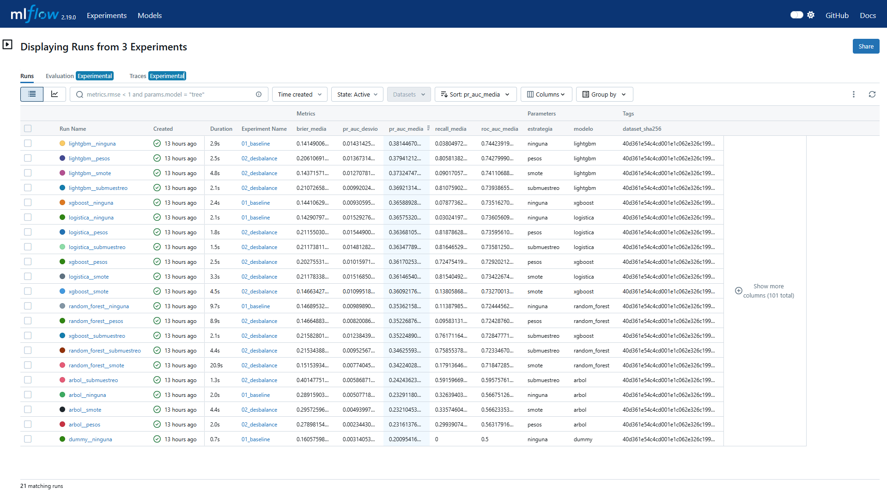

**Captura C.2.** Comparación de las cuatro estrategias en LightGBM. "Sin tratamiento" tiene la mayor PR-AUC y el menor Brier; las demás solo aumentan el recall con umbral 0,5.

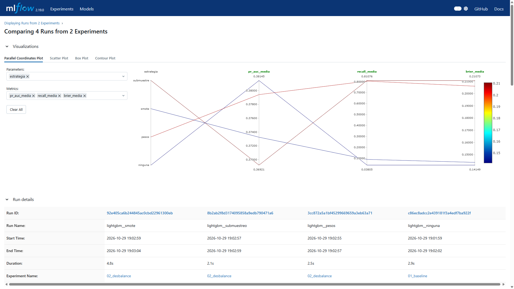

**Captura C.3.** Detalle de una corrida: etiquetas de trazabilidad (datos, *hash* del dataset, semilla, *commit* y etapa), parámetros y métricas.

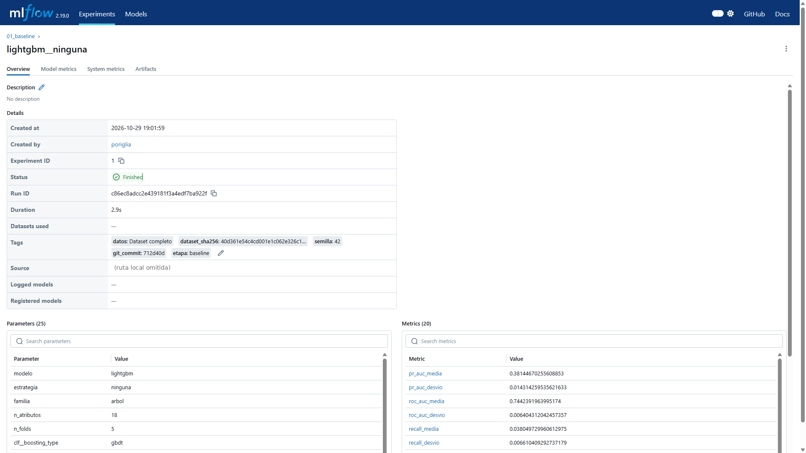

**Captura C.4.** Artefacto con las métricas de cada uno de los 5 folds de una corrida.

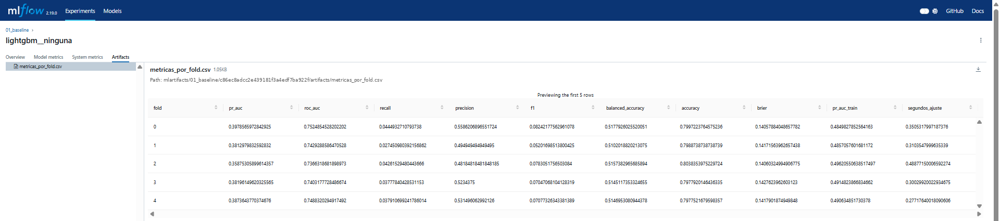

**Captura C.5.** Estructura de la optimización: cuatro estudios, con sus *trials* completos y podados. Los 60 *trials* de LightGBM aparecen anidados bajo su estudio (244 corridas en total).

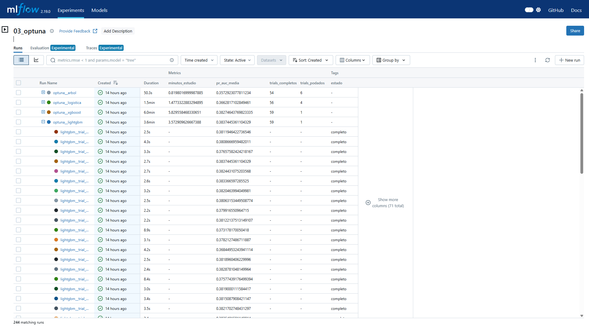

**Captura C.6.** Coordenadas paralelas de los 60 *trials* de LightGBM. Los mejores (en rojo) se concentran en pocos árboles, hojas con pocos turnos y tasas de aprendizaje moderadas.

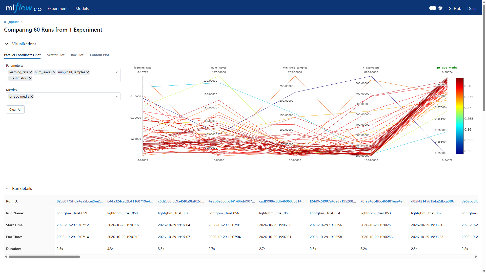

**Captura C.7.** Evaluación en prueba de los cinco modelos, con intervalos de confianza y umbral. El modelo final está vinculado a su versión registrada.

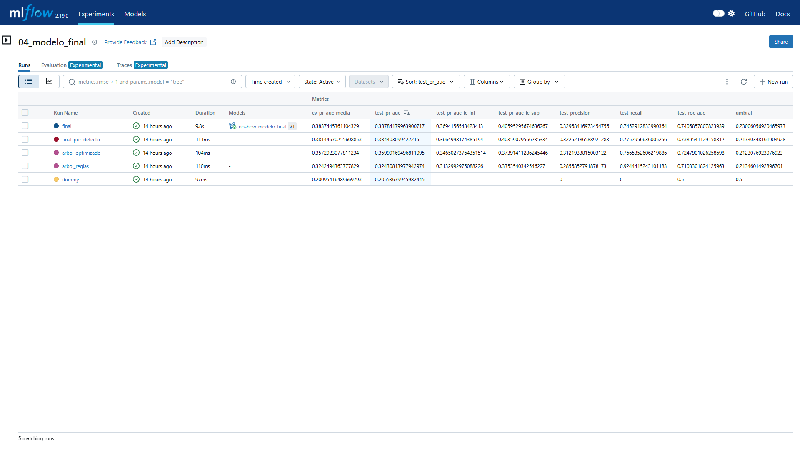

**Captura C.8.** Modelo registrado en el *Model Registry*, con su corrida de origen y su esquema de entrada (18 atributos) y salida (probabilidad).

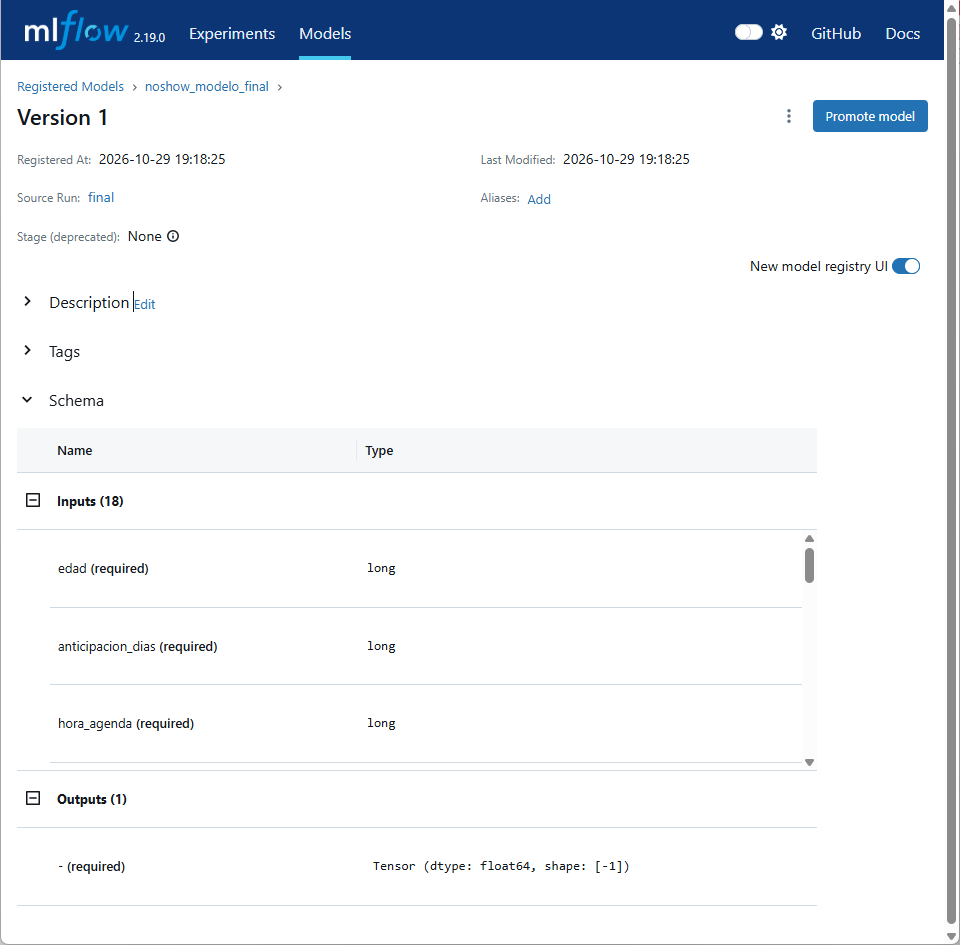

**Captura C.9.** Modelo empaquetado por MLflow: archivo `MLmodel` con la firma, el entorno de ejecución (`requirements.txt`, `conda.yaml`) y las figuras de evaluación adjuntas.

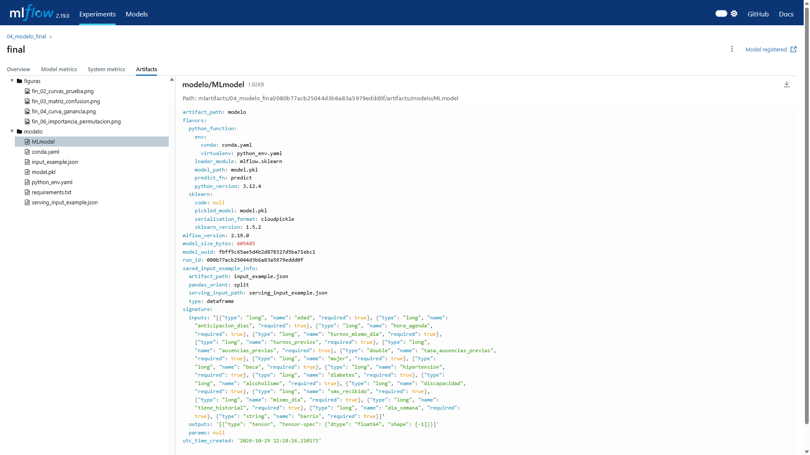

### Anexo D. Configuraciones de los modelos

**Tabla D.1.** Espacios de búsqueda de Optuna.

| Modelo | Hiperparámetro | Rango |
|---|---|---|
| LightGBM | `n_estimators` | 100 a 1.000 (escala logarítmica) |
| | `learning_rate` | 0,01 a 0,2 (log) |
| | `num_leaves` | 8 a 128 (log) |
| | `min_child_samples` | 10 a 300 (log) |
| | `subsample` / `colsample_bytree` | 0,5 a 1 / 0,4 a 1 |
| | `reg_alpha` / `reg_lambda` | 0,001 a 10 (log) |
| XGBoost | `n_estimators` | 100 a 1.000 (log) |
| | `learning_rate` | 0,01 a 0,3 (log) |
| | `max_depth` | 3 a 10 |
| | `min_child_weight` | 1 a 50 (log) |
| | `subsample` / `colsample_bytree` | 0,5 a 1 / 0,4 a 1 |
| | `reg_alpha` / `reg_lambda` | 0,001 a 10 (log) |
| Regresión Logística | `C` | 0,001 a 10 (log) |
| | `penalty` | l1 o l2 |
| Árbol de Decisión | `max_depth` | 3 a 20 |
| | `min_samples_leaf` | 5 a 500 (log) |
| | `criterion` | gini o entropy |
| Todos | Estrategia de desbalance | Sin tratamiento o ponderación de clases (el árbol, además, submuestreo) |

**Tabla D.2.** Mejores configuraciones encontradas.

| Modelo | Mejor *trial* | Hiperparámetros |
|---|---:|---|
| **LightGBM (final)** | 56 | `n_estimators`=108, `learning_rate`=0,052, `num_leaves`=50, `min_child_samples`=22, `subsample`=0,918, `colsample_bytree`=0,953, `reg_alpha`=0,020, `reg_lambda`=3,94 |
| XGBoost | 44 | `n_estimators`=384, `learning_rate`=0,011, `max_depth`=7, `min_child_weight`=12,9, `subsample`=0,763, `colsample_bytree`=0,733, `reg_alpha`=0,372, `reg_lambda`=0,002 |
| Regresión Logística | 51 | `C`=0,013, `penalty`=l2 |
| Árbol de Decisión | 37 | `max_depth`=18, `min_samples_leaf`=364, `criterion`=gini |

En los cuatro modelos, la mejor estrategia de desbalance fue **sin tratamiento**.

**Tabla D.3.** Parámetros de uso del modelo final.

| Elemento | Valor |
|---|---|
| Atributos de entrada | 18 (`edad`, `anticipacion_dias`, `hora_agenda`, `turnos_mismo_dia`, `turnos_previos`, `ausencias_previas`, `tasa_ausencias_previas`, `mujer`, `beca`, `hipertension`, `diabetes`, `alcoholismo`, `discapacidad`, `sms_recibido`, `mismo_dia`, `tiene_historial`, `dia_semana`, `barrio`) |
| Salida | Probabilidad de que el paciente no asista |
| Umbral de decisión | 0,230 (máximo F1 en predicciones fuera de fold) |
| Archivos | `models/modelo_final.joblib` y `models/modelo_final.json` (umbral, parámetros, *hash* y métricas) |
| Registro | MLflow *Model Registry*: `noshow_modelo_final`, versión 1 |
